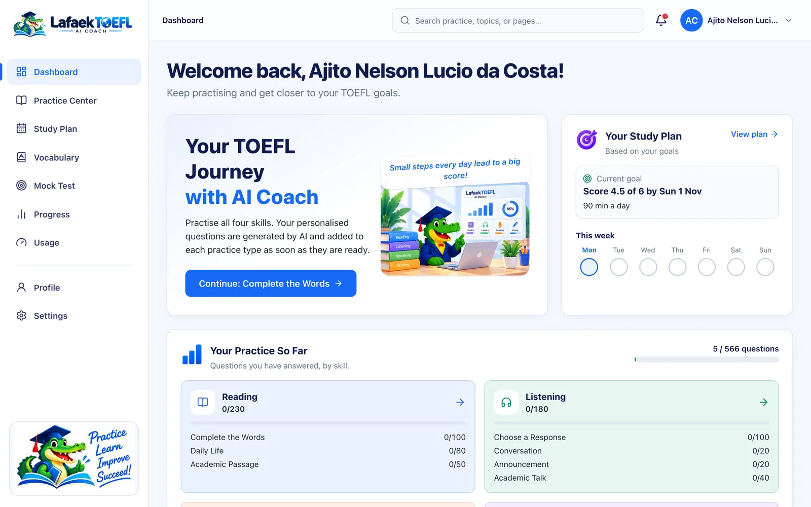
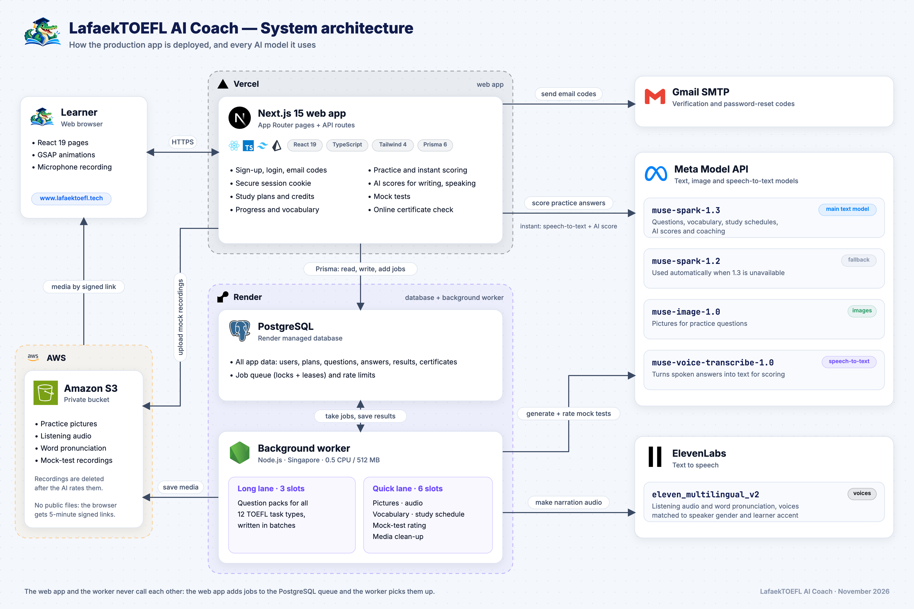

# LafaekTOEFL AI Coach

**A free, open-source AI coach for the new 2026 TOEFL iBT, built with Meta's Muse models.**

**[Try the live app](https://www.lafaektoefl.tech)** · **[Read the docs](https://www.lafaektoefl.tech/docs)** · [User guide](https://www.lafaektoefl.tech/docs/user-guide) · [How it works](https://www.lafaektoefl.tech/docs/how-it-works) · [Why I built it](https://www.lafaektoefl.tech/docs/story)



A learner writes a study plan, and AI builds a personal set of practice questions for all 12 task types of the TOEFL iBT that started in January 2026. The set comes with pictures, listening audio in the accents the learner chose, a vocabulary list and a week-by-week schedule. The learner gets instant AI scores for writing and speaking, can take a full timed mock test, and earns a certificate that anyone can verify online with a band of 4.0 or higher.

## Why it exists

I live in Dili, Timor-Leste, and I'm preparing for my first TOEFL so I can study in the United States. The prep books I ordered from Indonesia cost $50, took two weeks to arrive, and covered the old test. Official practice tests cost $49 each, and the free materials give no feedback on writing or speaking. The Meta Global AI Developer Hackathon gave me the chance to build the coach I couldn't find, free to start and open to everyone.

Read the full story: **[Why I built LafaekTOEFL](https://www.lafaektoefl.tech/docs/story)** ([on GitHub](https://github.com/ajitonelsonn/lafaek-toefl-ai-coach/blob/main/hystory/README.md)).

### Built during the hackathon

All of the code was written during the hackathon. Times below are in GMT+9 (Timor-Leste time), the same time zone as the official hackathon dates: 27 October, 2:00 AM – 5 November, 11:00 AM.

| When (GMT+9) | Commit | What it contains |
| --- | --- | --- |
| 26 Oct 2026, 11:43 PM | [`492a661`](https://github.com/ajitonelsonn/lafaek-toefl-ai-coach/commit/492a6610e23b02677396e6f1eb685e63283e3347) | I made this commit after I was notified that I was accepted. It only created the repository with the MIT `LICENSE` file, and contains no code. |
| 27 Oct 2026, 1:39 PM | [`6e0720d`](https://github.com/ajitonelsonn/lafaek-toefl-ai-coach/commit/6e0720da0a987a3b883fa42b4b246d42b0285e03) | The first code commit. All of the app's code was committed from this point on. |

The full history is in the [commit log](https://github.com/ajitonelsonn/lafaek-toefl-ai-coach/commits/main).

## What it does

| Feature | Details |
| --- | --- |
| **AI study plan** | Level, target band (1–6), test date, study days, minutes per day and accents become a dated, day-by-day plan. Muse Spark personalises each week. |
| **All 12 TOEFL 2026 task types** | Complete the Words, Read in Daily Life, Academic Passage, four listening tasks, Build a Sentence, Write an Email, Academic Discussion, Listen and Repeat, Take an Interview |
| **Personal questions** | About 133 questions per plan, written by Muse Spark in the real 2026 formats and checked before a learner sees them. The full plan is ready in 10–15 minutes. |
| **AI scores and coaching** | Emails, discussion posts and interview answers get a band (1–6) with feedback, based on ETS's 2026 scoring criteria |
| **Real accents** | American, British, Australian, Indian and African English voices, matched to each speaker's gender |
| **Vocabulary** | Words chosen from the learner's own questions, with IPA, meaning, example and pronunciation |
| **Full mock test** | All 12 task types, timed by section, with no pause or replay. Every section gets a band and a CEFR level. |
| **Verifiable certificates** | An overall band of 4.0 or higher (B2) earns a certificate with an ID and QR code, checked on a public page |
| **Free to start** | Starter is free for life (1 plan, 1 mock test). A Boost Pack costs $5 (+1 plan, +2 mock tests). The project is MIT open source. |
| **Cheap to run** | One complete study plan costs about **$3.16** in AI calls, measured on the live app. See [Cost per study plan](https://www.lafaektoefl.tech/docs/cost). |

See every screen in the **[user guide](https://www.lafaektoefl.tech/docs/user-guide)** ([on GitHub](https://github.com/ajitonelsonn/lafaek-toefl-ai-coach/blob/main/docs/user-guide/README.md)).

## Built with Meta's models

| Provider | Model | Used for |
| --- | --- | --- |
| Meta | `muse-spark-1.3` | Main text model: questions, vocabulary, study schedules, AI scores and coaching |
| Meta | `muse-spark-1.2` | Fallback, used automatically when 1.3 is unavailable |
| Meta | `muse-image-1.0` | Pictures for practice questions |
| Meta | `muse-voice-transcribe-1.0` | Speech-to-text for spoken answers |
| ElevenLabs | `eleven_multilingual_v2` | Listening audio and word pronunciation (Meta has no text-to-speech model) |

## Architecture



- **Web app on Vercel:** Next.js 15, React 19 and TypeScript. It serves all pages and API routes, and scores practice answers instantly.
- **Background worker on Render (Singapore, 0.5 CPU / 512 MB):** handles the long AI work. It writes questions, makes pictures and audio, chooses vocabulary, plans schedules and rates mock tests.
- **PostgreSQL on Render:** all data, plus the **job queue** and rate limits. The web app and the worker never call each other; they share work through the queue.
- **AWS S3:** a private bucket for media. The browser only gets 5-minute signed links.

Five diagrams explain each flow step by step: **[How it works](https://www.lafaektoefl.tech/docs/how-it-works)** ([on GitHub](https://github.com/ajitonelsonn/lafaek-toefl-ai-coach/blob/main/docs/diagram/README.md)).

## Documentation

All docs are published at **[lafaektoefl.tech/docs](https://www.lafaektoefl.tech/docs)**, with search, and are also readable here on GitHub.

| Guide | What's inside | Read |
| --- | --- | --- |
| Our story | Why the app exists | [Docs](https://www.lafaektoefl.tech/docs/story) · [GitHub](https://github.com/ajitonelsonn/lafaek-toefl-ai-coach/blob/main/hystory/README.md) |
| User guide | Every screen, with screenshots | [Docs](https://www.lafaektoefl.tech/docs/user-guide) · [GitHub](https://github.com/ajitonelsonn/lafaek-toefl-ai-coach/blob/main/docs/user-guide/README.md) |
| How it works | Architecture, generation, mock test, auth and database diagrams | [Docs](https://www.lafaektoefl.tech/docs/how-it-works) · [GitHub](https://github.com/ajitonelsonn/lafaek-toefl-ai-coach/blob/main/docs/diagram/README.md) |
| Cost per study plan | What one plan really costs in AI calls (measured: about $3.16) | [Docs](https://www.lafaektoefl.tech/docs/cost) · [GitHub](https://github.com/ajitonelsonn/lafaek-toefl-ai-coach/blob/main/docs/cost/README.md) |
| Developer guide | This README: setup, technical details, deployment | [Docs](https://www.lafaektoefl.tech/docs/developer-guide) |

## Run it yourself

**Stack:** Next.js 15 (App Router) · React 19 · TypeScript · Tailwind CSS 4 · PostgreSQL (Prisma 6) · Meta Model API · ElevenLabs · Amazon S3 · Nodemailer (Gmail SMTP) · GSAP · Vitest.

```bash
npm install                 # also runs `prisma generate`
cp .env.example .env.local  # fill in values locally; never commit .env.local
npm run db:deploy           # apply migrations (uses DATABASE_URL from the environment)
npm run db:seed             # load the shared, hand-written starter set (idempotent)
npm run dev                 # web app on http://localhost:3000
npm run worker              # background generation worker (separate terminal)
```

`npm run verify:providers` checks Meta, ElevenLabs, SMTP and AWS access with minimal calls and prints no secrets.

### Environment

All variables are listed in `.env.example`.

- Anything without `NEXT_PUBLIC_` is server-only.
- The app checks its configuration per feature, only when that feature is used. A missing integration (for example `S3_BUCKET`) disables only that feature.
- The error message names the missing variable, never its value.

## Technical details

```text
Browser ──fetch──▶ Next.js route handlers (app/api/*) ──▶ PostgreSQL (source of truth)
                         │                                  ▲
                         ├─ Meta: AI scoring, speech-to-text │
                         └─ S3: short-lived signed URLs     │
Worker (npm run worker) ── claims jobs from the queue ──────┘
   ├─ study_schedule:  Meta outline of the learner's calendar → validated → dated days
   ├─ task_pack:       Meta text → Zod validate → bounded repair → store questions
   ├─ vocabulary_pack: Meta picks words from those questions → stored per learner
   ├─ asset_image:     Meta image → S3
   ├─ asset_audio:     ElevenLabs speech → S3
   └─ mock_scoring:    transcribe + rate the mock test's open answers
```

- **Auth.**
  - Email and password. Passwords are hashed with `scrypt`.
  - Sign-up is confirmed with a 6-digit email code. The code is stored only as an HMAC, expires after 10 minutes, allows 5 attempts and works once.
  - Sessions are a random token in an `HttpOnly`, `SameSite=Lax` cookie (`__Host-` and `Secure` in production). Only the token's SHA-256 hash is stored.
  - Every request that changes data checks `Origin`.
  - Login, email codes, generation, feedback and uploads are rate-limited in PostgreSQL.
  - Forgot-password points to the configured administrator (`ADMIN_CONTACT_EMAIL`).
- **Authorization.**
  - The `(app)` layout requires a valid server session.
  - Every query is scoped to the signed-in user, and "not yours" returns the same 404 as "not found".
- **Content.**
  - Each learner sees the shared **starter set** (hand-written, original) plus their own **personalised items**.
  - Personalised items are generated once per study plan: one batch per user and plan version, behind an idempotency key.
  - Answer keys stay on the server. Objective tasks are scored with versioned logic (`objective-1`).
  - Answer choices are shuffled per item, so the correct answer is not always "A".
- **Study plans.**
  - **Dated schedule.**
    - The plan counts the days from the learner's local "today" to the test date, which can be the same day or up to one year ahead.
    - Study days fall on the weekdays the learner chose, up to the day before the test.
    - Without a test date, the length depends on level: 6–12 weeks.
    - Code: `lib/server/study-plan-builder.ts`.
  - **Daily content.**
    - Each study day is filled within the learner's daily minutes, from the week's priority tasks (weak skills first), plus vocabulary review.
    - A mock test is placed 3–6 days before the test, and the last study day is a light review.
  - **AI personalisation.**
    - Saving a plan shows the rule-based schedule at once and queues a `study_schedule` job.
    - In the worker, Meta proposes a week-by-week outline. It is validated against the real calendar, and invalid parts keep the rule-based week.
    - Code: `lib/server/generation/study-schedule.ts`.
  - **Credits.**
    - Every save uses one study-plan credit (the first plan, an edit, or a new plan).
    - Without a credit, the server returns `402 UPGRADE_REQUIRED` and the page shows **Upgrade · $5**.
- **Generation jobs.**
  - **Job types:**
    - `study_schedule`;
    - `task_pack`: 12 per plan, 133 questions in total, with default counts in `lib/config/practice-types.ts`;
    - `vocabulary_pack`, `asset_image`, `asset_audio`, `mock_scoring`, `delete_user_assets` and `reconcile_media`.
  - **Reliability.** Jobs use leases with heartbeats, expired-lease recovery, exponential backoff with jitter, per-user concurrency limits and per-item checkpoints. Completed items are never regenerated.
  - **Two lanes.**
    - Question packs (`task_pack`) run in a long lane: `WORKER_CONCURRENCY`, default 3.
    - Everything else runs in a quick lane with its own slots: `WORKER_QUICK_CONCURRENCY`, default 6, and up to 4 per learner. That covers audio, pictures, vocabulary, the schedule and mock-test rating.
    - Short jobs never wait behind a pack that takes minutes.
  - **Build a Sentence** is written and checked in batches of 5 with low model reasoning (`reasoning_effort: "low"`). That is about 8× faster, with the same pass rate on the grammar check.
  - **Model problems.**
    - On `model_not_found`, Meta calls retry 3 times, then use `META_TEXT_FALLBACK_MODEL` (`muse-spark-1.2`).
    - A rejected key waits as `PROVIDER_CONFIG` instead of failing.
    - Usage events are idempotent by provider request ID.
- **Question formats.**
  - Generated questions follow the TOEFL iBT 2026 formats (lengths, question counts and question types), checked against published practice tests.
  - The content is always original.
  - Complete the Words blanks are made in code, the same way as the real task (`lib/server/content/c-test.ts`).
- **Vocabulary.**
  - There is no fixed word list. When a practice type's questions are finished, a `vocabulary_pack` job asks Meta for up to 10 useful words from those questions.
  - Words that do not occur in the texts, or that the learner already has, are dropped.
  - Pronunciation comes from ElevenLabs. The clip is made the first time a word is played and stored privately in S3.
- **Voices.**
  - Each speaker has a gender, and the picture shows the same people, so a woman in the picture speaks with a female voice.
  - Voices follow the accents chosen in the study plan (American, British, Australian, Indian, African), rotating across items.
  - Every accent has a female and a male voice. American and British voices are ElevenLabs standard voices built into the app. The others come from the ElevenLabs Voice Library and are listed in `ELEVENLABS_VOICE_IDS` as `id:accent:gender`.
  - **Production voices** (all tested on 2 November 2026):

    | Accent | Female | Male |
    | --- | --- | --- |
    | American | Sarah, Laura, Jessica, Matilda, Aria (built in) | Brian, Chris, Eric, Will, Liam, Roger (built in) |
    | British | Alice, Lily (built in) | George, Daniel (built in) |
    | Australian | Voice Library `p43fx6U8afP2xoq1Ai9f` | Charlie (built in), Voice Library `7AJyv0vI6pBx5JTb9p6C` |
    | Indian | Smita `ctgnaLIeDdomGMnEAjYf` | Saagar `2DRBj9T2XZ7Jmkcm6WCZ` |
    | African (South African English) | Annabel `nV2afREa5mKDMAIpqMu0` | Sizwe `qp5KnBkVXn1iOyKYgIDA` |

  - **To use the same voices in your own copy:**
    1. Add each Voice Library voice to your own ElevenLabs account (*Add to My Voices*).
    2. Set the following line:

    ```text
    ELEVENLABS_VOICE_IDS=ctgnaLIeDdomGMnEAjYf:indian:female,2DRBj9T2XZ7Jmkcm6WCZ:indian:male,nV2afREa5mKDMAIpqMu0:african:female,qp5KnBkVXn1iOyKYgIDA:african:male,p43fx6U8afP2xoq1Ai9f:australian:female,7AJyv0vI6pBx5JTb9p6C:australian:male
    ```

  - Set it on the worker (listening audio) and on Vercel (word pronunciation). The new voices apply to newly generated audio; questions that already exist keep their voices.
  - If an accent has no voice of the speaker's gender, the learner's other chosen accents are used.
- **Speaking.**
  - The browser converts recordings to 16 kHz mono WAV, and Meta `muse-voice-transcribe-1.0` transcribes them.
  - Listen and Repeat counts as correct when at least 80% of the words match.
  - Recordings are discarded after transcription unless the learner turns on *Keep my speaking recordings*.
- **Writing and interview scores.**
  - Emails, discussion posts and interview answers get an **AI score (band 1–6)** plus coaching, in about 10–15 s (`POST /api/practice/items/:id/feedback`).
  - The criteria are shared with the mock test (`lib/server/rating-criteria.ts`, based on ETS's 2026 scoring dimensions).
- **Plans and upgrades** (`lib/config/pricing.ts`, `lib/server/credits.ts`). There is no subscription, and credits never expire.
  - **Starter**, free for life: 1 study plan and 1 mock test.
  - **Boost Pack**, $5 per pack: +1 study plan and +2 mock tests. Learners email the admin, and the admin adds the packs (see [Upgrade an account](#upgrade-an-account-boost-pack)).
  - **Open Source:** self-host from GitHub for personal, non-commercial use. Business use needs the admin's agreement.
  - Credits are used atomically under a per-user advisory lock, so two requests at once cannot overspend.
- **Mock test** (`lib/server/mock-test.ts`).
  - **Contents:** all 12 task types, about 80 questions in about 90 minutes.
    - Reading: Complete the Words 1, Read in Daily Life 3, Academic Passage 2.
    - Listening: Choose a Response 5, Conversation 2, Announcement 2, Academic Talk 2.
    - Writing: Build a Sentence 10, Email 1, Academic Discussion 1.
    - Speaking: Listen and Repeat 1 (7 sentences), Interview 1 (4 questions).
  - **Starting** uses one mock credit. Reloading resumes the test without using another credit.
  - **Signed form:** the browser gets the chosen questions in an HMAC-signed token, so a submission scores exactly those questions, once, for that user.
  - **Timing:** Reading 30, Listening 29, Writing 23 and Speaking 8 minutes. There is no pause, audio plays once, spoken answers cannot be re-recorded, and right or wrong is not shown during the test.
  - **Scoring.**
    - Reading, Listening and Build a Sentence are scored on submit.
    - The email, the discussion post and the interview are rated by AI in the worker (`mock_scoring`).
    - Recordings are deleted after rating.
    - Every section gets a band (1–6), and the overall band is their average.
  - **Certificates.**
    - An overall band of 4.0 or higher earns a certificate with an ID and QR code.
    - Anyone can check it at `/verify/<ID>` (`lib/server/certificates.ts`).
    - Learners without one can open a watermarked preview.
- **Docs site** (`app/docs`, `lib/server/docs.ts`).
  - `/docs` renders the Markdown guides listed in `lib/config/docs.ts` at build time, with search, a table of contents and GSAP motion.
  - Images are resized to WebP during the build.
- **Interface motion (GSAP).** Every animation is turned off when the device asks for reduced motion (`lib/client/motion.ts`).
  - The loading screen is the crocodile logo breaking into pieces and snapping back together.
  - Pages, results, flashcards and toasts have short entrance effects.
  - The mock test has a "preparing" screen and a submit screen with a progress ring.

## Commands

| Command | What it does |
| --- | --- |
| `npm run lint` / `npm run typecheck` / `npm run build` | Quality gates |
| `npm test` | Unit and integration tests (integration uses the isolated `lafaek_test` schema) |
| `E2E_BASE_URL=http://localhost:3200 npx vitest run tests/e2e` | HTTP end-to-end tests against a server started with the test schema |
| `node scripts/check-secrets.mjs` | Fails if any secret value appears in client bundles or git-tracked files |
| `npm run db:status` / `npm run db:deploy` | Migration status / apply |
| `npm run worker` / `npm run worker:prod` | Generation worker (`--once` drains the queue and exits) |
| `npm run upgrade:grant -- <email> [packs] [note]` | Upgrades an account with Boost Packs (uses the `.env.local` database) |
| `npm run upgrade:grant:prod -- <email> [packs] [note]` | The same on the production worker (Render Shell) |

New migrations: change `prisma/schema.prisma`, then create a migration with `prisma migrate diff` and apply it with `db:deploy`. Render users usually cannot create the shadow database that `migrate dev` needs.

### Upgrade an account (Boost Pack)

There is no subscription. The paid upgrade is the **Boost Pack** ($5): each pack adds **1 study plan and 2 mock tests**, for life. Learners ask for it by email: the *Upgrade* button opens a prefilled message to the admin. After they have paid, the admin adds the packs:

```bash
# From your computer (uses DATABASE_URL in .env.local)
npm run upgrade:grant -- learner@example.com                          # 1 pack: +1 study plan, +2 mock tests
npm run upgrade:grant -- learner@example.com 3 "paid by bank transfer" # 3 packs, with a note

# On the server: Render dashboard → the worker → Shell
npm run upgrade:grant:prod -- learner@example.com 1 "paid by bank transfer"
```

- The email must belong to an existing account, and each command adds 1 to 20 packs.
- Every grant is recorded in `credit_grants`, and the learner's Usage page shows the new plan, for example "Starter + 1 Boost Pack".
- An admin user (`role = 'admin'`) can do the same through `POST /api/admin/upgrades`, which also writes an audit event.

## Deployment

- **Web (Vercel).**
  - Set the variables from `.env.example` for each environment in Vercel's settings.
  - Use Render's *external* database URL with `sslmode=require`.
  - Run `prisma migrate deploy` once per release.
  - Set `APP_URL` to the custom domain on both Vercel and the worker. It is used for links in emails.
- **Worker (Render Background Worker).** Vercel only runs short request handlers, so the worker needs its own host. Without it, generation jobs stay queued.
  - **Region: Singapore.** Meta's API lists no models to Render's Ohio network, but works from Singapore.
  - **Build command:** `npm ci --include=dev`. `tsx` and `prisma` are devDependencies.
  - **Start command:** `npm run worker:prod`.
  - **Instance size: 0.5 CPU / 512 MB is enough.** A learner's whole plan is ready in about **10–15 minutes**:
    - what that covers: the AI schedule, all 133 questions, vocabulary, audio and pictures;
    - why a larger instance would not help: the worker mostly waits on the AI and voice APIs.
  - **Alternative:** a cron job can `POST /api/internal/worker/tick` with `Authorization: Bearer $WORKER_TICK_SECRET` to process one job per call.
- **Live deployment.**
  - The web app runs at **https://www.lafaektoefl.tech** (Vercel), and the worker runs on Render in Singapore.
  - The database is PostgreSQL on Render, and media is in AWS S3.
- **S3.**
  - Use a private bucket with Block Public Access and server-side encryption.
  - Give the IAM user least privilege on that one bucket (`s3:PutObject`, `s3:GetObject`, `s3:DeleteObject`, `s3:ListBucket`).
- **Admin.**
  - Set `role = 'admin'` on a user in the database.
  - `GET /api/admin/jobs` lists failed or blocked jobs, and `POST /api/admin/jobs/:id/retry` retries one.

## Data retention

| Data | Kept | Deletion |
| --- | --- | --- |
| Email codes | HMAC only, 10-minute validity | Superseded codes are invalidated; rows go when the account is deleted |
| Sessions | 30 days (`SESSION_TTL_DAYS`) | Revoked on logout; all deleted with the account |
| Practice recordings | Only with opt-in consent | Learner can delete each one; deleted with the account |
| Mock test recordings | Until the AI rating finishes (about a minute) | Deleted by the `mock_scoring` job; the result keeps bands and short comments |
| Certificates | While the account exists | Deleted with the account; a revoked one shows "Revoked" on the check page |
| Practice answers, plans, generated items, usage | While the account exists | `DELETE /api/account` deletes all rows and queues S3 clean-up |
| Rate-limit counters | 2 days | Pruned by the worker |

## Scores and costs

- **Score scale.** The TOEFL iBT 2026 scale is used throughout: bands from 1 to 6 in 0.5 steps, with CEFR levels (6 C2, 5–5.5 C1, 4–4.5 B2, 3–3.5 B1, 2–2.5 A2, 1–1.5 A1). See `lib/config/toefl-scale.ts`.
- **Scores are practice estimates.** All scores and feedback are practice estimates, never official ETS/TOEFL scores. Speaking is judged from transcripts, so pronunciation itself is not scored.
- **Costs.**
  - Meta calls return token usage, which is stored per call in `usage_events`.
  - ElevenLabs returns no usage data, so characters are stored as estimates.
  - `GENERATION_DAILY_USER_LIMIT` caps generation per learner per day.

## Project structure

```text
app/(public)/      landing, login, signup, verify-email, forgot-password, certificate check
app/(app)/         signed-in pages (server components fetch data via lib/server)
app/api/           route handlers (Zod-validated, request IDs, sanitized errors)
app/docs/          the /docs site
components/        UI, layout, practice engine, study-plan calendar, mock test, docs, motion, charts
docs/              user guide (with screenshots) and architecture diagrams
hystory/           the story behind the project
lib/config/        practice types, navigation, assets, pricing, docs list
lib/client/        browser helpers: API client, WAV encoder, GSAP motion setup
lib/practice/      client-safe DTOs (never contain answer keys)
lib/server/        server-only: env, db, auth, providers, storage, content, generation, docs
prisma/            schema, migrations, starter content
scripts/           worker, seed, provider checks, upgrades, secret scan
tests/             unit, integration (isolated schema), e2e (HTTP)
```

## Known limitations

- Indian, African and Australian voices come from the ElevenLabs Voice Library, so a self-hosted copy must add them to its own ElevenLabs account first (see *Voices*). Audio made before 2 November 2026 used the learner's other chosen accents in place of these three.
- Starter-set items have no generated audio yet and use the browser's voice. They also predate some 2026 formats.
- Practice AI scores and speaking transcription run in Vercel route handlers (usually 10–15 s, within the 60 s limit). If they ever time out, they can move to the worker queue, as the mock test rating already does.
- There is no self-service password reset, and Google sign-in is not implemented.
- AI bands for Writing and Speaking are model estimates. Results and certificates say so.

## License

MIT, see [LICENSE](LICENSE). TOEFL is a registered trademark of ETS; this project is not affiliated with ETS.
