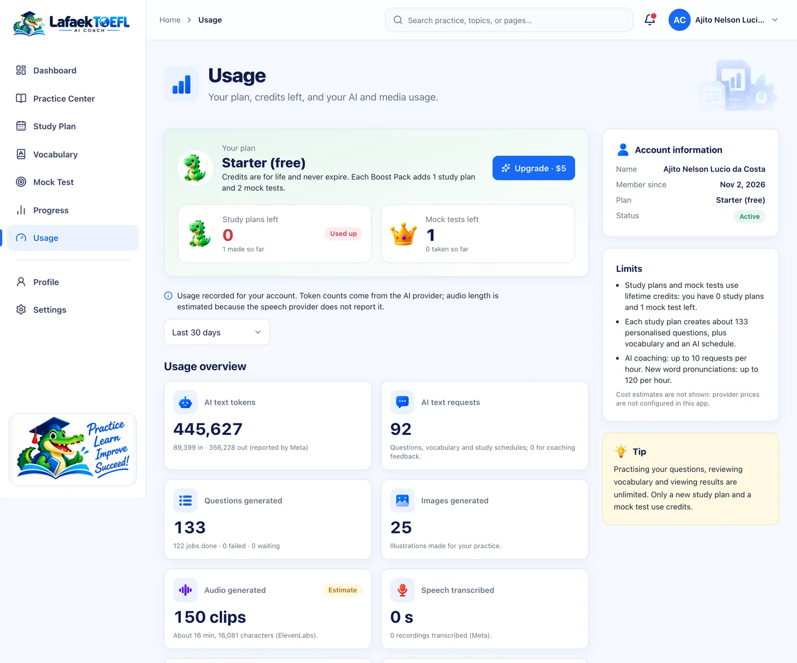
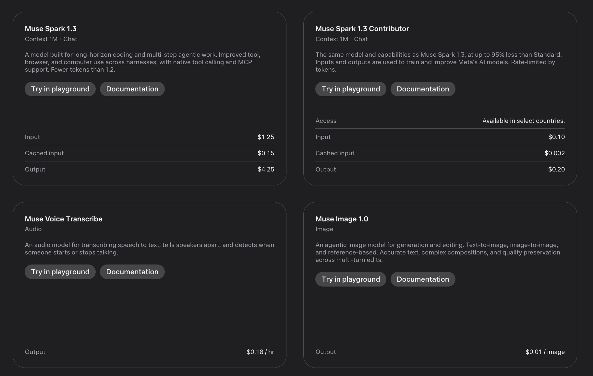
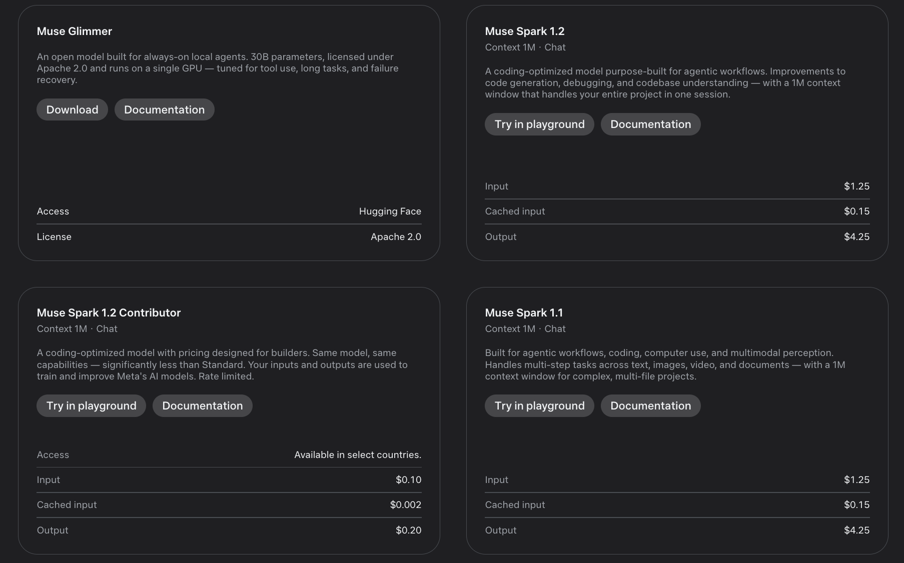
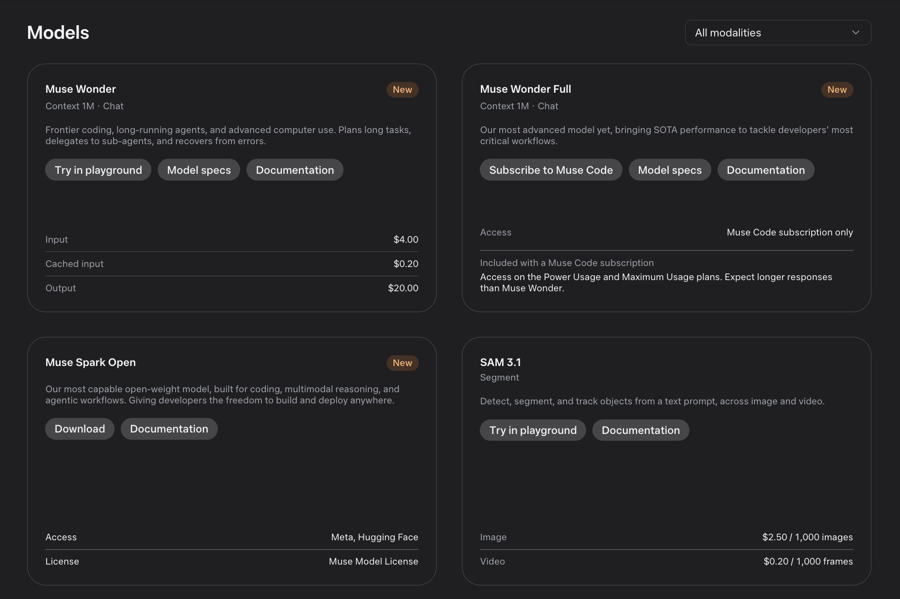

# Cost per study plan

How much does it cost to give one learner a full, personal TOEFL study plan? We measured it on the live app instead of guessing.

**Answer: about $3.16 for a complete study plan**, which includes:

- 133 personal questions across all 12 TOEFL task types;
- the AI study schedule;
- 120 vocabulary words;
- 25 pictures and 150 voice clips.

That is about **$0.024 per question**.

## How we measured it

On 2 November 2026 we created a brand-new account on [lafaektoefl.tech](https://www.lafaektoefl.tech) and made one study plan, choosing every option:

- all 7 study days, 90 minutes a day and a test on 25 February 2027;
- all four skills as weak areas;
- all five accents.

The plan was ready in **13 minutes**. The account had done nothing else, so its usage totals are exactly the cost of one plan.

The app records every AI call in its `usage_events` table:
- for Meta, the provider and model, plus the input and output tokens Meta reports;
- for ElevenLabs, the characters sent.

The account's **Usage** page shows the totals:

## What one study plan used

| Item | Amount |
| --- | --- |
| Meta text calls (questions, checks, vocabulary, schedule) | 92 requests |
| Input tokens (Muse Spark) | 89,399 |
| Output tokens (Muse Spark, including reasoning) | 356,228 |
| Pictures (Muse Image) | 25 |
| Voice characters (ElevenLabs) | 16,081 characters in 150 clips (about 16 minutes of audio) |
| Speech-to-text | none (only used when a learner speaks) |
| Result | 133 questions, 120 vocabulary words, 1 AI schedule, 122 finished jobs, 0 failed |
| Files stored in S3 | 175 files, 18.5 MB |

## Prices used

| Model | Provider | Price |
| --- | --- | --- |
| `muse-spark-1.3` (and the fallback `muse-spark-1.2`, same price) | Meta | $1.25 per 1M input tokens · $0.15 per 1M cached input tokens · $4.25 per 1M output tokens |
| `muse-image-1.0` | Meta | $0.01 per image |
| `muse-voice-transcribe-1.0` | Meta | $0.18 per hour of audio |
| `eleven_multilingual_v2` | ElevenLabs | $0.08 per 1,000 characters |

Sources:
- **Meta:** prices from the Meta Model API model list (screenshots below), which match independent reports such as [MindStudio](https://www.mindstudio.ai/blog/muse-spark-1-3-pricing).
- **ElevenLabs:** the [ElevenLabs API pricing page](https://elevenlabs.io/pricing/api). Some third-party sites list $0.10 per 1,000 characters for the same model.
- **Cached input:** the app does not track cached tokens, so all input is priced at the full rate. The real cost can only be the same or lower.

## The cost of one study plan

| Part | Calculation | Cost |
| --- | --- | --- |
| Muse Spark input | 89,399 × $1.25 / 1M | $0.112 |
| Muse Spark output | 356,228 × $4.25 / 1M | $1.514 |
| Muse Image pictures | 25 × $0.01 | $0.250 |
| ElevenLabs voices | 16,081 × $0.08 / 1,000 | $1.286 |
| **Total** | | **$3.16** |

- At $0.10 per 1,000 characters for voices, the total would be **$3.48**.
- Storage is negligible: 18.5 MB in S3 costs well under one cent a month.

**Where the money goes:**
- About **half** of the cost is Muse Spark's output tokens. Most of these are the model's reasoning while it writes and checks questions, about 2,700 output tokens per question.
- About **40%** is voices for the listening tasks.
- **Pictures** are about 8%.

## Other AI costs

| Action | What it uses | Cost |
| --- | --- | --- |
| AI score and coaching for one email, discussion post or interview answer | Measured: 935 input + 1,244 output tokens | **$0.0065** |
| Speaking answer, plus speech-to-text | A 45-second answer is 0.0125 hours × $0.18 | about $0.002 more |
| Full mock test with AI rating (estimate) | 11 transcriptions (about 3.5 minutes of speech) and 2 rating calls | about **$0.04** |
| Word pronunciation | Made once per word, the first time it is played | about $0.001 per word |

The mock-test figure is an estimate. We measured our test run, but its answers were left empty, so it used no AI calls.

## What this means for pricing

| Plan | Price to the learner | AI cost to run it | Difference |
| --- | --- | --- | --- |
| Starter: 1 study plan + 1 mock test | Free | about $3.20 | −$3.20 |
| Boost Pack: +1 study plan + 2 mock tests | $5 | about $3.24 | about +$1.76 |

- The hackathon's **$150 in Meta Model API credits** covers the Meta part of about **80 study plans** ($1.88 each). With ElevenLabs included, $150 covers about 47 full plans.
- Hosting is a fixed monthly cost and is not counted per plan. It covers the Vercel web app, the Render worker and database, and S3.
- Compare this with prep materials: one official ETS practice test costs $49, and a writing or speaking evaluation from a prep site costs $27–$29 each.

## How to make it cheaper

- **Muse Spark 1.3 Contributor:** $0.10 per 1M input and $0.20 per 1M output tokens.
  - It would cut the text part from $1.63 to about **$0.08** per plan, so the whole plan would cost about **$1.62**.
  - The catch: inputs and outputs are used to train Meta's models, and it is available only in select countries. That needs the learner's consent.
- **ElevenLabs Flash or Turbo:** $0.04 per 1,000 characters would halve the voice cost to about $0.64.
- **Fewer reasoning tokens:** Build a Sentence already uses `reasoning_effort: "low"`, which made it about 8× faster. Using low reasoning for more task types would cut output tokens further.

## Meta's published prices

Screenshots of the Meta Model API model list, taken during the hackathon:

