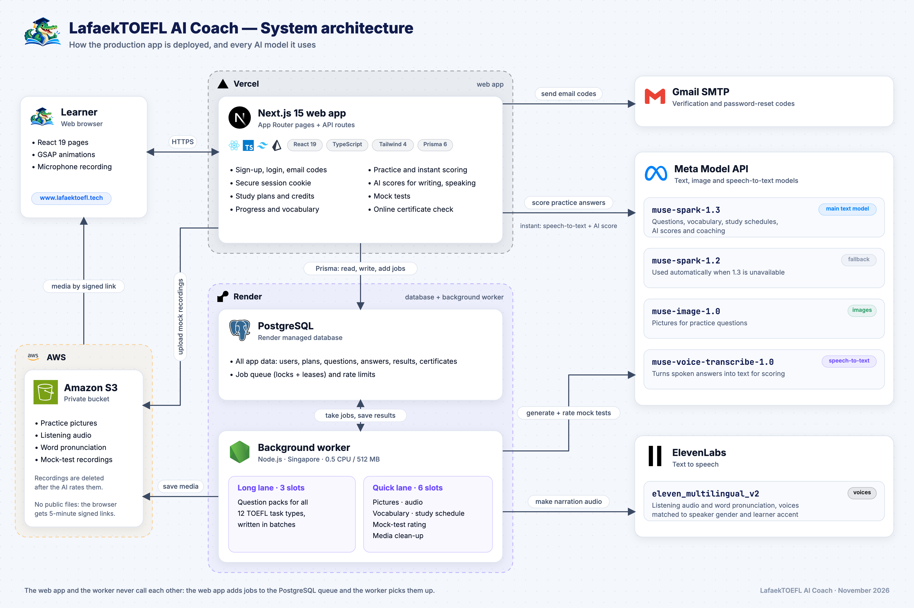
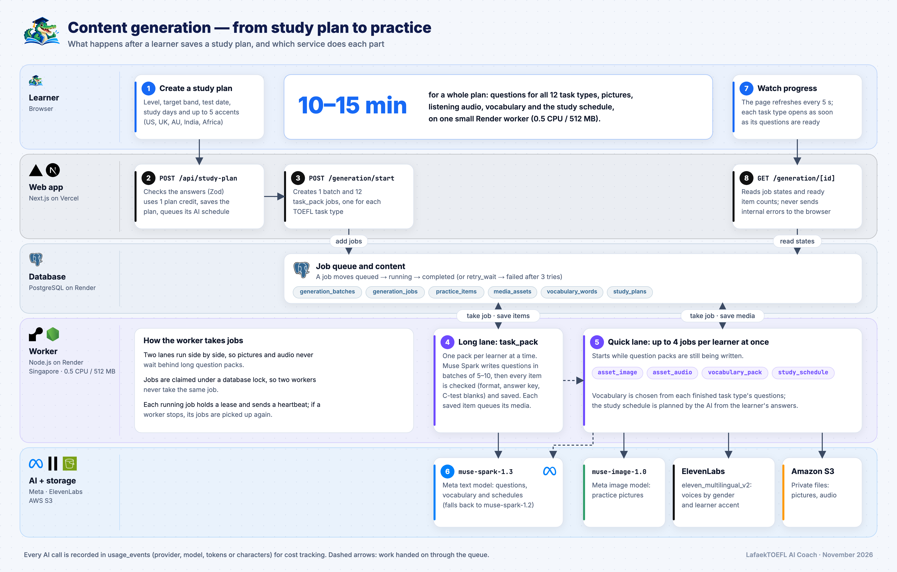
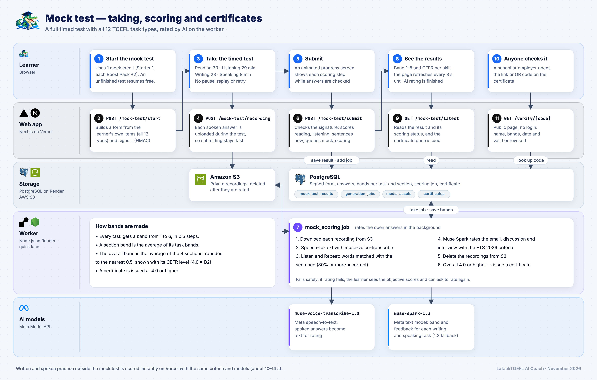
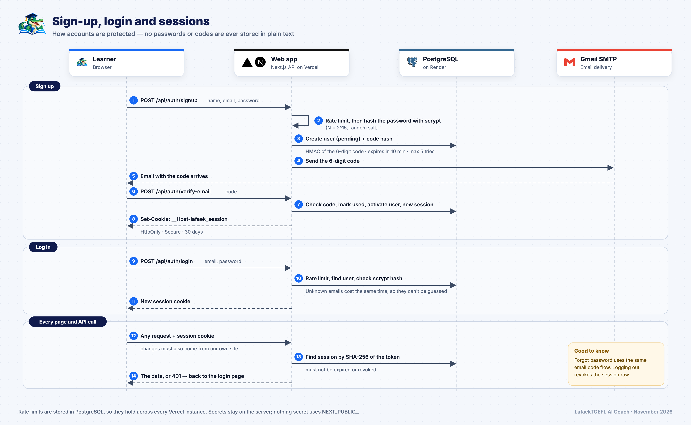
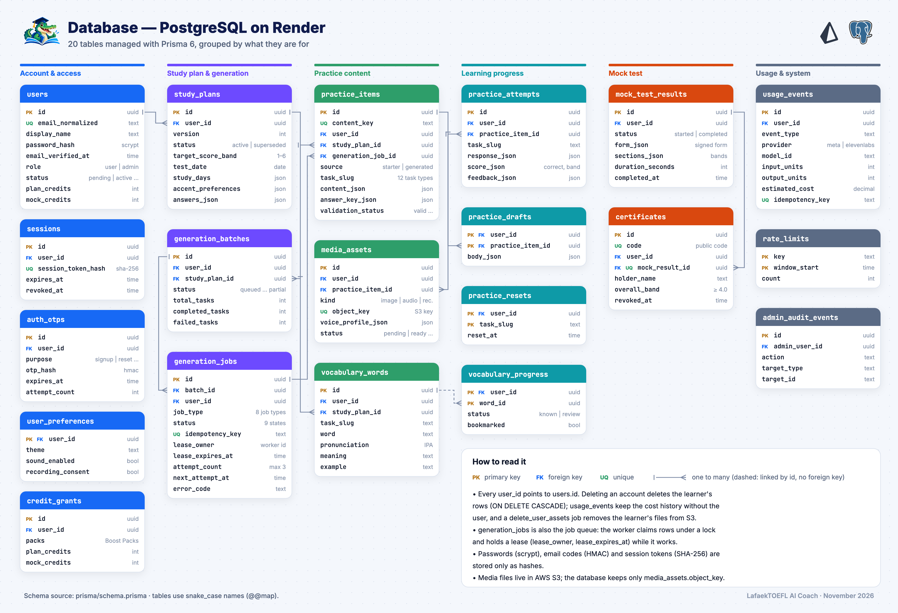

# How LafaekTOEFL AI Coach works

LafaekTOEFL AI Coach is a TOEFL iBT (2026 format) practice app. A learner writes a study plan, and AI builds a personal set of practice questions for all 12 TOEFL task types, with pictures, listening audio, vocabulary and a study schedule. The learner practises, gets instant AI scores for writing and speaking, and can take a full timed mock test. A score of 4.0 or higher earns a certificate that anyone can check online.

The five diagrams below explain how it works, from the big picture down to the database.

1. [System architecture](#1-system-architecture)
2. [Content generation](#2-content-generation--from-study-plan-to-practice)
3. [Mock test](#3-mock-test--taking-scoring-and-certificates)
4. [Sign-up, login and sessions](#4-sign-up-login-and-sessions)
5. [Database](#5-database)

---

## 1. System architecture

The app runs on four services, each doing what it is best at.

| Service                                        | Where                               | What it does                                                                                                              |
| ---------------------------------------------- | ----------------------------------- | ------------------------------------------------------------------------------------------------------------------------- |
| **Web app** (Next.js 15, React 19, TypeScript) | Vercel                              | All pages and API routes: sign-up and login, study plans, practice, instant scoring, mock tests, certificate checks       |
| **Background worker** (Node.js)                | Render, Singapore, 0.5 CPU / 512 MB | Long AI work: writing questions, making pictures and audio, choosing vocabulary, planning the schedule, rating mock tests |
| **Database** (PostgreSQL, through Prisma)      | Render                              | All app data, plus the job queue and the rate limits                                                                      |
| **File storage** (Amazon S3)                   | AWS                                 | Pictures, listening audio, word pronunciation and mock-test recordings in a private bucket                                |

The app uses these AI models:

| Provider   | Model                       | Used for                                                                                                                                           |
| ---------- | --------------------------- | -------------------------------------------------------------------------------------------------------------------------------------------------- |
| Meta       | `muse-spark-1.3`            | Main text model: writes questions, vocabulary and study schedules; scores and coaches writing and speaking                                         |
| Meta       | `muse-spark-1.2`            | Fallback, used automatically when 1.3 is unavailable                                                                                               |
| Meta       | `muse-image-1.0`            | Pictures for practice questions                                                                                                                    |
| Meta       | `muse-voice-transcribe-1.0` | Speech-to-text for spoken answers                                                                                                                  |
| ElevenLabs | `eleven_multilingual_v2`    | Listening audio and word pronunciation. Voices match each speaker's gender and the learner's chosen accents (US, UK, Australian, Indian, African). |

Gmail SMTP sends the verification and password-reset codes.

**The key design choice:** the web app and the worker never call each other. When the web app needs long work done, it adds a job to a queue table in PostgreSQL, and the worker picks it up. This means:

- Web requests stay fast. Vercel never waits minutes for AI generation, and no request hits a timeout.
- Nothing is lost when the worker restarts. Jobs stay in the database and are picked up again.
- There is no extra queue service to run or pay for.

There are two exceptions where the web app calls the AI directly, because the learner is waiting for the answer:

- Practice answers are scored instantly. Speech-to-text and the AI score take about 10–14 seconds, well within Vercel's limit.
- Verification emails are sent straight away.

**Media is never public.** Files sit in a private S3 bucket. The browser gets a signed link that works for 5 minutes, and only after the server has checked that the file belongs to that learner.

---

## 2. Content generation — from study plan to practice

This is what happens after a learner saves a study plan. A whole plan takes **10–15 minutes** on one small worker.

1. **The learner creates a study plan:** level, target band, test date, study days, minutes per day and up to 5 accents.
2. **`POST /api/study-plan`** checks the answers, uses 1 plan credit, saves the plan and queues a job to plan the AI study schedule.
3. **`POST /api/generation/start`** creates one _batch_ with 12 `task_pack` jobs, one for each TOEFL task type.
4. **Long lane (`task_pack`).** The worker takes one pack per learner at a time and asks Muse Spark to write questions in small batches (5–10 per call). Every item is checked before it is saved:
   - its format against a schema;
   - that the answer key is valid;
   - for Complete the Words, the letter blanks follow the C-test rule.

   Answer choices are shuffled, so the right answer is not always "A".

5. **Quick lane.** Each saved item queues its own small jobs: `asset_image` makes the picture and `asset_audio` makes the listening audio. When a task type is finished, `vocabulary_pack` picks words from its questions. `study_schedule` plans the weeks. These start while the long packs are still being written, so the learner can begin earlier.
6. **The AI models:**
   - Muse Spark writes the text.
   - Muse Image draws the pictures.
   - ElevenLabs speaks the audio, with a voice that matches each speaker's gender and the learner's accents.
   - Finished files go to S3.
7. **The learner watches progress.** The page refreshes every 5 seconds, and each task type opens as soon as its questions are ready.
8. **`GET /api/generation/[id]`** reads the job states from the database. Internal error details are never sent to the browser.

**How the worker takes jobs:**

- **Two lanes.** The worker runs two lanes side by side: long question packs (3 slots) and quick media jobs (6 slots). Pictures and audio never wait behind a long pack.
- **No double work.** Jobs are claimed under a database lock, so two workers never take the same job.
- **Recovery.** A running job holds a _lease_ and sends a heartbeat. If a worker stops, its jobs are picked up again.
- **Retries.** A failed job is retried up to 3 times. The learner can retry a failed task type from the progress page.
- **Cost tracking.** Every AI call is recorded in `usage_events` (provider, model, tokens or characters).

---

## 3. Mock test — taking, scoring and certificates

A mock test is a full, timed test made from the learner's own practice items and covering all 12 task types.

1. **Start.** Starting uses 1 mock credit. An unfinished test resumes without using another credit.
2. **`POST /api/mock-test/start`** builds the test form and **signs it (HMAC)**. The answers are checked against the signed form, so the browser cannot change the questions or the answer key.
3. **The timed test.** Reading 30 min, Listening 29 min, Writing 23 min, Speaking 8 min. Like the real test, there is no pause, replay or retry, and right or wrong is not shown during the test.
4. **`POST /api/mock-test/recording`.** Each spoken answer is uploaded to S3 _during_ the test, so submitting stays fast.
5. **Submit.** An animated screen shows the progress while the answers are checked.
6. **`POST /api/mock-test/submit`** checks the signature. It then scores Reading, Listening and Build a Sentence immediately and queues a `mock_scoring` job for the open answers.
7. **The `mock_scoring` job on the worker:**
   1. downloads each recording from S3;
   2. turns speech into text with `muse-voice-transcribe-1.0`;
   3. checks Listen and Repeat by matching the words with the sentence (80% or more counts as correct);
   4. has `muse-spark-1.3` rate the email, the academic discussion and the interview against the ETS 2026 criteria;
   5. **deletes the recordings** from S3;
   6. issues a certificate if the overall band is 4.0 or higher.
8. **Results.** The learner sees a band from 1 to 6 and the CEFR level for each skill. The page refreshes every 8 seconds until the AI rating is done.
9. **`GET /api/mock-test/latest`** returns the result, its scoring status and the certificate.
10. **Anyone can check a certificate.** A school or employer opens the link or QR code printed on the certificate.
11. **`/verify/[code]`** is a public page showing the name, bands, date and whether the certificate is valid or revoked.

**How bands are made:**

- Each task gets a band from 1 to 6, in steps of 0.5.
- A section's band is the average of its tasks.
- The overall band is the average of the 4 sections, rounded to the nearest 0.5 and shown with its CEFR level (4.0 = B2).
- If AI rating fails, the learner still sees the objective scores and can ask for the rating to run again.

---

## 4. Sign-up, login and sessions

**Sign up (steps 1–8):**

- The learner sends name, email and password.
- The server applies a rate limit and hashes the password with **scrypt**.
- It creates a _pending_ user and a 6-digit email code. Only an **HMAC of the code** is stored. The code expires in 10 minutes and allows at most 5 tries.
- Gmail SMTP sends the code.
- When the learner enters it, the server marks the code as used, activates the account and starts a session.

**Log in (steps 9–11):**

- The server checks the password hash.
- Unknown emails take the same time as real ones, so attackers cannot discover which emails have accounts.
- A new session cookie is set.

**Every page and API call (steps 12–14):**

- The browser sends the session cookie: `__Host-lafaek_session`, HttpOnly, Secure, valid for 30 days.
- The database stores only the **SHA-256 hash** of the session token. Even someone who reads the database cannot log in as a learner.
- Requests that change data must also come from our own site (same-origin check).
- Forgot password uses the same email-code flow, and logging out revokes the session.

Rate limits live in PostgreSQL, so they apply across every Vercel instance. Secrets (API keys, database URL, SMTP password, AWS keys) stay on the server and are never sent to the browser.

---

## 5. Database

PostgreSQL on Render holds 20 tables, managed with Prisma. They fall into six groups:

| Group                   | Tables                                                                           | Purpose                                                                                                   |
| ----------------------- | -------------------------------------------------------------------------------- | --------------------------------------------------------------------------------------------------------- |
| Account & access        | `users`, `sessions`, `auth_otps`, `user_preferences`, `credit_grants`            | Accounts, hashed passwords, hashed sessions and email codes, settings, credits (Starter plus Boost Packs) |
| Study plan & generation | `study_plans`, `generation_batches`, `generation_jobs`                           | The learner's plan and the **job queue** the worker reads                                                 |
| Practice content        | `practice_items`, `media_assets`, `vocabulary_words`                             | Each learner's own questions, their pictures and audio (stored as S3 keys), and vocabulary                |
| Learning progress       | `practice_attempts`, `practice_drafts`, `practice_resets`, `vocabulary_progress` | Answers, scores and AI feedback, unsent drafts, per-task resets, known and review words                   |
| Mock test               | `mock_test_results`, `certificates`                                              | The signed test form, bands per section, and certificates with a public code                              |
| Usage & system          | `usage_events`, `rate_limits`, `admin_audit_events`                              | AI cost tracking, rate limiting, admin actions                                                            |

The tables connect like this:

- Every `user_id` points to `users.id`.
- Deleting an account deletes the learner's rows. A `delete_user_assets` job removes their files from S3. `usage_events` keep the cost history without the user.
- `generation_jobs` is both a record and the queue. The worker claims rows under a lock and holds a lease (`lease_owner`, `lease_expires_at`) while it works.
- Media files are never stored in the database, only their S3 object key.

---
