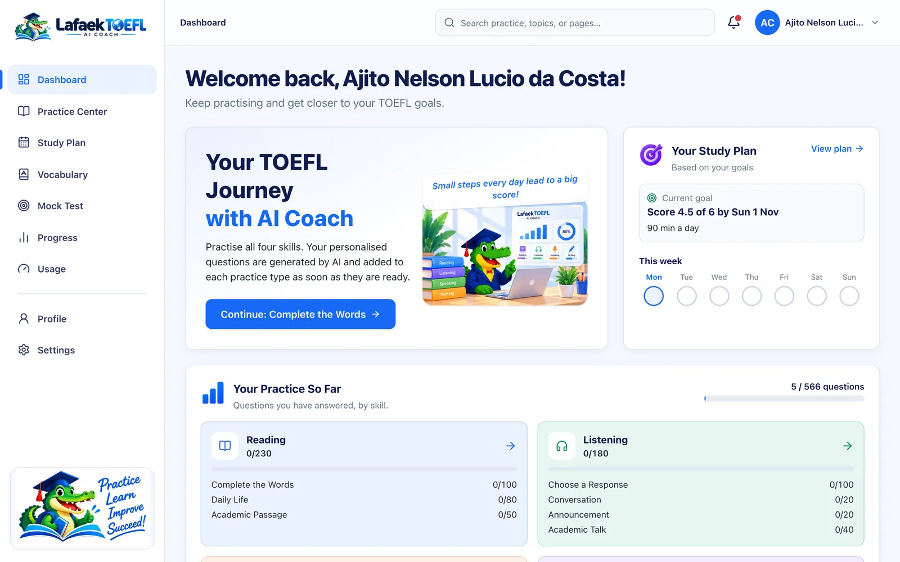
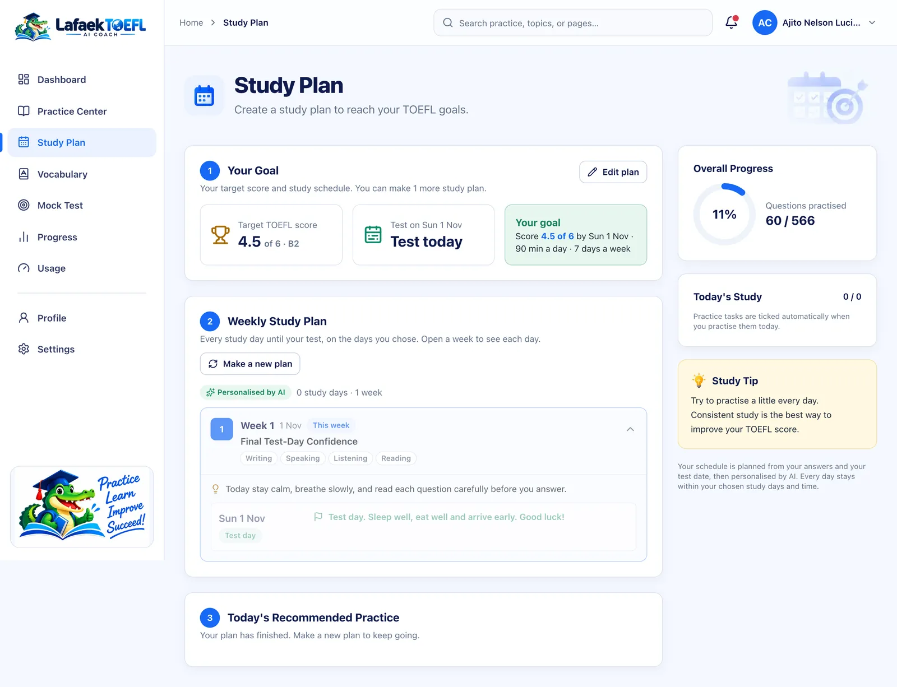
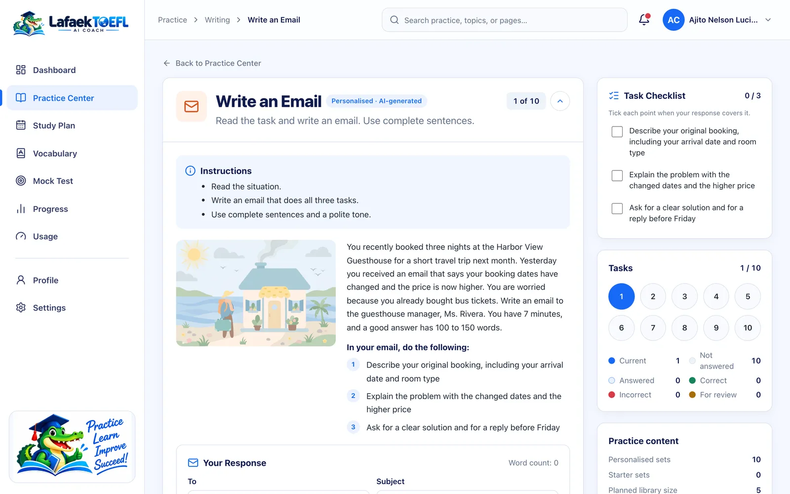

# User guide

This guide walks through LafaekTOEFL AI Coach as a learner sees it, from creating an account to earning a certificate. Every screenshot comes from the live app at [lafaektoefl.tech](https://www.lafaektoefl.tech), using a real account that has a study plan, practice history and a finished mock test.

## 1. Start for free

The home page explains what the app does and lets you start straight away. Practice is free to start, the project is open source, and the questions are generated by AI.

There is no subscription, and credits never expire.

| Plan | Price | What you get |
| --- | --- | --- |
| **Starter** | Free, for life | 1 personal AI study plan, 1 full mock test, all 12 practice types, vocabulary with natural voices, progress tracking |
| **Boost Pack** | $5 per pack | +1 study plan and +2 mock tests. Buy as many packs as you need. |
| **Open Source** | Free | Deploy your own copy from GitHub for personal, non-commercial use |

## 2. Create your account

Sign up with your name, email and a password of at least 8 characters, including letters and a number. We email you a 6-digit code to confirm your address. The code works once and expires after 10 minutes.

After that, you log in with your email and password.

## 3. Your dashboard

The dashboard is your home inside the app. It shows:

- a **Continue** button that takes you back to where you stopped;
- your **study plan**: your goal and this week's study days;
- **your practice so far**: how many questions you have answered in each skill and practice type.

## 4. Make your study plan

The study plan is where personalisation starts. You tell the app:

- your current level and your **target band** (1–6, for example 4.5 = B2);
- your **test date**, the **days** you can study and **how many minutes** a day;
- the skills you find hardest;
- which **accents** you want to hear: American, British, Australian, Indian and African English.

Saving the plan uses 1 study-plan credit. The app then shows a **week-by-week plan** for every study day until your test. A badge marks the parts that were **personalised by AI**. Each day lists the practice tasks and vocabulary review that fit in your daily minutes, and the last day before the test is a light review.

In the background, the AI writes about **133 personal questions** for your plan across all 12 practice types. It also makes pictures, listening audio and a vocabulary list, which takes about 10–15 minutes. Each practice type opens as soon as its questions are ready, so you can begin while the rest is still being made.

## 5. Practise all 12 TOEFL task types

The **Practice Center** has every task type of the TOEFL iBT that started in January 2026, grouped by skill. Filter by skill, or search for a task type. Each card shows how many of your personalised questions are ready.

| Skill | Practice types |
| --- | --- |
| Reading | Complete the Words · Read in Daily Life · Read an Academic Passage |
| Listening | Listen and Choose a Response · Listen to a Conversation · Listen to an Announcement · Listen to an Academic Talk |
| Writing | Build a Sentence · Write an Email · Write for an Academic Discussion |
| Speaking | Listen and Repeat · Take an Interview |

Every practice page works the same way:

- The **instructions** come first.
- The **question navigator** on the right shows which questions you have answered, got right, got wrong or marked for review.
- After you **check** an answer, you see whether it was right and an explanation. Answer choices are shuffled, so the right answer is not always "A".

### Reading

**Complete the Words** is the new C-test task: type the missing letters of each word in a paragraph. The blanks are made the same way as in the real test.

**Read in Daily Life** uses short everyday texts, such as emails, notices, menus and schedules, each with its own questions.

### Listening

The listening tasks play real voices. Each speaker gets a voice that matches the person in the picture, in one of the accents you chose. As in the real test, the audio plays **once**, and the questions appear when it ends.

### Writing

**Build a Sentence:** put the words in the right order to answer the first speaker. Click a word to place it, or drag it into a blank.

**Write an Email** and **Write for an Academic Discussion** give you a situation and a checklist of what to include, and count your words as you write. When you check your answer, the AI gives you a **band score (1–6)** and coaching on what to improve. It uses criteria based on the official TOEFL 2026 scoring.

### Speaking

In **Take an Interview**, an interviewer asks you four questions. You record each answer, the app turns your speech into text, and the AI scores it and gives feedback.

In **Listen and Repeat**, you hear a sentence and say it back. A sentence counts as correct when at least 80% of its words match.

## 6. Learn vocabulary from your own questions

The AI chooses useful words from **your own practice questions**, so every word comes with a context you have already read or heard. Each card shows:

- the IPA pronunciation, with an audio button;
- a simple meaning and an example sentence;
- which practice type the word came from.

Mark a word with **Know it**, send it to **Review again**, or **save** it to your own list. The word list, review queue and quiz help you go over the words again.

## 7. Track your progress

The Progress page shows:

- how many questions you have practised, and your accuracy;
- how many practice types you have tried, and your practice time;
- **accuracy over time** and **by skill**, with your average AI score for writing and speaking;
- progress on each of the 12 practice types;
- recommendations for what to practise next.

## 8. Take a full mock test

The mock test is a complete practice TOEFL that covers all 12 task types. It is built from your own questions that you have not used in a mock test before.

- Each section has its own timer: **Reading 30 min, Listening 29 min, Writing 23 min and Speaking 8 min**.
- Test conditions apply: **no pause, no replay and no retry**.
- Right or wrong is **not shown** during the test.
- Starting a test uses 1 mock-test credit. If you reload the page, the test continues without using another credit.

## 9. See your results

Reading, Listening and Build a Sentence are scored as soon as you submit. Your email, discussion post and spoken answers are rated by AI in the background, which takes about a minute.

You then get:

- a **band (1–6) and CEFR level for every section**;
- an **overall band**, which is the average of the four sections;
- comments on your writing and speaking;
- a history of all your mock tests.

## 10. Earn a certificate

With an overall band of **4.0 or higher (B2)**, you earn a **certificate of achievement**. It has its own ID and QR code, and you can print it, save it as a PDF, copy its link or add it to LinkedIn. Anyone can confirm it is real on the public verification page, without logging in:

Not there yet? The **certificate preview** shows what you will earn, with a "Preview" watermark.

## 11. Credits, usage and settings

The **Usage** page shows:

- your plan (for example "Starter + 2 Boost Packs");
- how many study plans and mock tests you have left;
- your upgrade history;
- your AI and media usage.

To get more credits, use **Upgrade · $5**, which opens an email to the admin.

In **Settings** you choose:

- the theme: light, dark or the same as your device;
- whether sound plays during practice;
- whether to keep your speaking recordings. They are deleted right after transcription unless you turn this on.

## 12. Use it on your phone

Every page works on a phone, including practice with audio and recording.

  
  

---

All scores in LafaekTOEFL are **practice estimates**, not official ETS/TOEFL scores. TOEFL is a registered trademark of ETS; this project is not affiliated with ETS.
