# VR Study Room

> Practise the new TOEFL in a calm virtual classroom on Meta Quest, with your own study-plan questions and nothing but your hands.

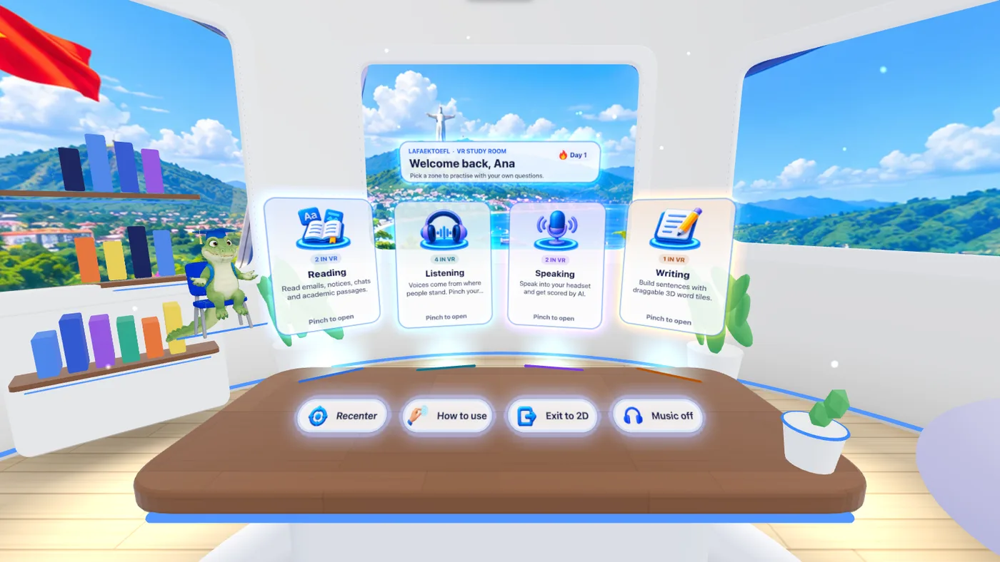

*The hub, seen in Preview mode on a computer. On a Quest, the room surrounds you.*

## Why VR?

Preparing for the TOEFL alone is hard to keep up. A book or a laptop screen looks the same every day, a phone is always one notification away, and speaking practice means talking to an empty screen. Many learners give up on the routine long before the test, not because the material is too hard, but because it gets boring.

The VR Study Room turns the same practice into a place you go to, and something you do with your hands:

- **A place to study, not another tab.** Put on the headset and you sit at your own desk in a bright classroom inspired by Timor-Leste, with Dili and Cristo Rei outside the windows. There are no other tabs and no phone in front of you, just the next question.
- **Learn by doing.** In Build a Sentence you pick up word tiles and put them in order, so grammar becomes a small puzzle you solve with your hands. Answers are cards you point at and pinch.
- **Speak to someone, not to a laptop.** In Take an Interview, Lafaek the crocodile sits across the desk and asks each question out loud, its mouth moving with its voice. Answering a face in the room feels much closer to the real interview than reading a prompt off a screen.
- **Hear who is talking.** In Listening, real-looking people stand or sit to your left and right, and each voice comes from where that person is. Their mouths and hands move while they speak, and the listener turns towards the talker, so telling speakers apart works the way it does in a real room.
- **Short sessions that fit your day.** You stay seated, and one activity takes a few minutes. When you come back, the room continues where you stopped.
- **A reason to come back.** The hub counts your study days. Turn around, and a live progress wall behind you shows your questions answered, accuracy, study days, practice by skill, mock-test band and certificate. It updates every time you finish an activity.
- **The same coach, not a separate game.** The room uses the questions made for your study plan and the same AI scoring as the website. Everything you do in VR counts in your progress on the website, and the other way round.

## Built for hands, a chair and a few minutes

The room was designed around four simple tests:

| Test | How the room meets it |
| --- | --- |
| **Hands only.** Can you finish everything without a controller? | Yes. Every screen works with three hand gestures: point and pinch, pinch and hold, and touch. Signing in needs no typing on the headset either. Controllers work too, but nothing needs them. |
| **An airplane seat.** Does every interaction fit within arm's reach of a chair? | Yes. You never stand or walk. Answers and buttons float in front of you, the dock is 45 cm away on the desk, and **Recenter** fits the desk to your chair. |
| **One bus stop.** Can you have a complete moment in a short ride? | Yes. One activity is a few minutes: read and answer, build a sentence, hear a conversation, or answer one interview question and get your score. The room remembers where you stopped. |
| **No sign-up wall.** Can someone try it straight away? | Yes. **Try the demo, no account** opens the room in one tap, with sample questions and real scoring. |
| **Take it away.** Is there still an app without a third-party service? | Yes. The room, its interactions, the questions, the scoring flow and the progress tracking are all our own. AI models write and score the content, but the experience is not a wrapper around a chat window. |

## What you need

- A **Meta Quest** headset with the **Quest Browser**. There is nothing to install.
- A LafaekTOEFL account with a **study plan**. The room uses the questions made for your plan.
- Or no account at all: see [Try it without an account](#try-it-without-an-account).
- A chair. Everything works seated, within arm's reach, and **no controllers are needed**.

No headset? On a computer, the welcome card shows **Preview the room** as its main button: the room opens in the browser, and you look around and press with the mouse. **Enter VR** stays greyed out there, because a computer's browser cannot start VR.

## Try it without an account

Anyone can step into the room in one tap, with no sign-up, email or study plan:

1. Open **[lafaektoefl.tech/vr](https://www.lafaektoefl.tech/vr)**, or the room itself, and choose **Try the demo, no account**.
2. The room opens with **"Welcome to the demo"**. Choose **Enter VR** on a Quest, or **Preview the room** on a computer.
3. Practise any of the 9 tasks with **sample questions**: real study-plan questions with their pictures and voices. Your answers and progress are your own; nobody else sees them, and you do not change anyone else's.

Good to know:

- **Speaking is real but limited.** Listen and Repeat and the interview give a real transcript and AI score, up to 12 spoken answers and 8 AI scores a day for each guest.
- **The demo stays in the VR area.** Going back to the app (**Leave the demo**, the logo, or any app page) signs the guest out and opens the home page. Create a free account to get your own study plan and keep your progress.
- **Guest data is temporary.** A guest's answers and progress are deleted after 48 hours.

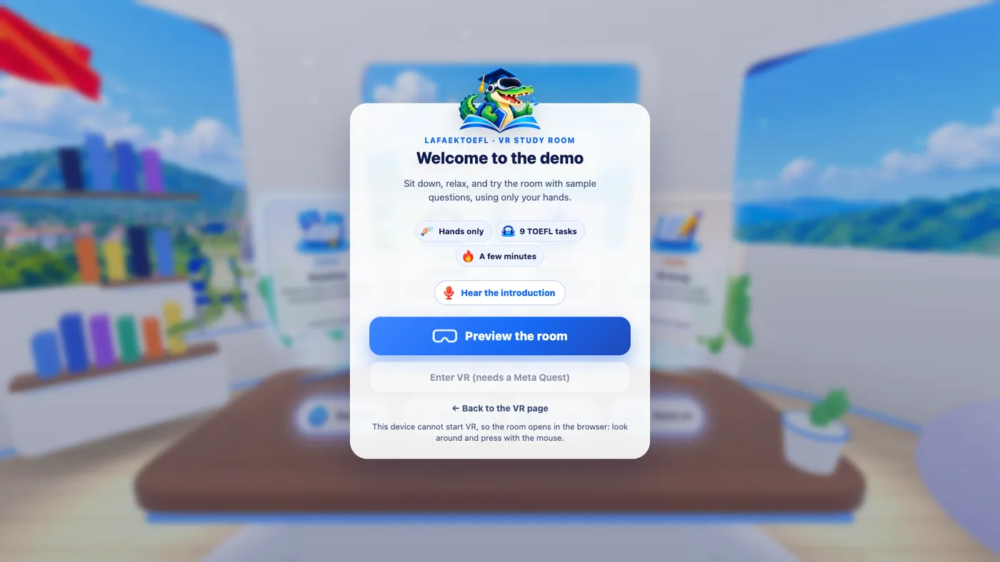

## Getting in

1. In the Quest Browser, open **[lafaektoefl.tech/vr](https://www.lafaektoefl.tech/vr)**. The page checks that the browser can start VR.
2. **Sign in without typing a password.** On your phone or laptop, where you are already signed in, open the VR page and tap **Sign in on Quest**. A code appears. On the Quest, open **lafaektoefl.tech/link** and type the code, then tap **Approve** on your phone or laptop. The Quest signs itself in.
3. The room opens with a **welcome card**. Tap **Hear the introduction** for a 24-second spoken tour, then choose **Enter VR** and allow hand tracking if the Quest asks.
4. A short tutorial shows how to use your hands. If the desk looks too high or too low, press **Recenter**.

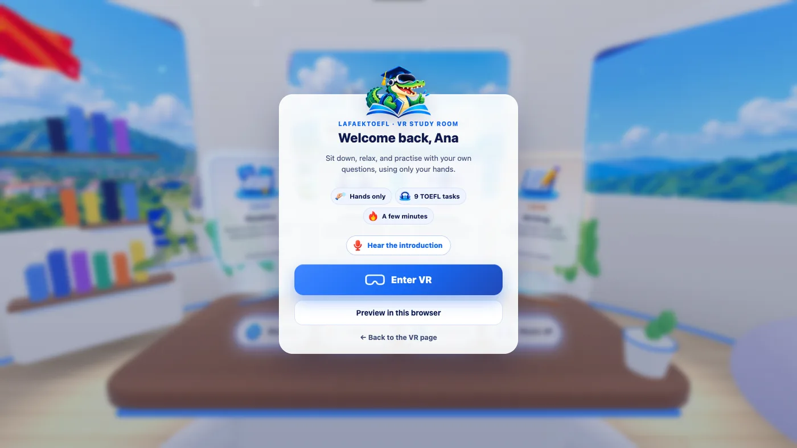

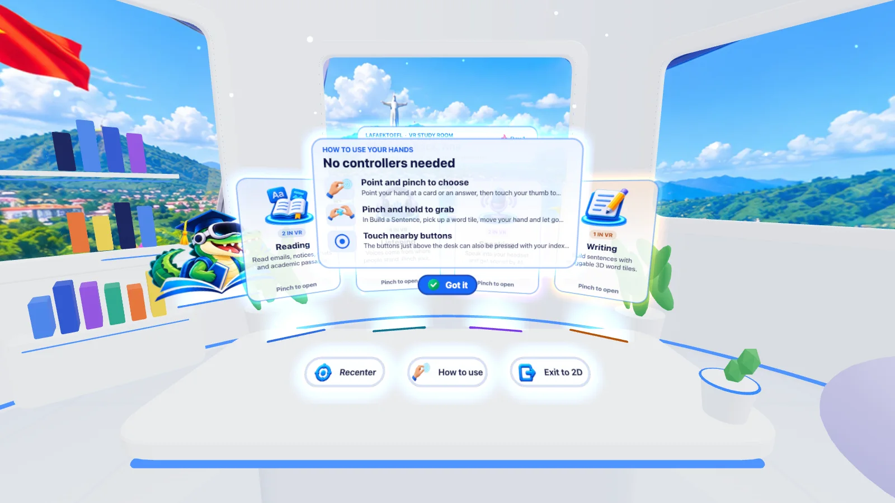

## Using your hands

| Gesture | How | Used for |
| --- | --- | --- |
| **Point and pinch** | Point your hand at a card, then touch your thumb to your index finger. It acts when your fingers part, so sliding off a button cancels it. | Zones, activities, answers, page buttons |
| **Pinch and hold to grab** | Pinch a word tile, move your hand, and let go over a slot. Pinching a tile once also sends it to the next free slot. | Build a Sentence |
| **Touch** | Press a button with your index finger. | The dock just above the desk |

The **dock** floats just above the desk, within arm's reach: **Back** (or **Exit to 2D** in the hub), **How to use**, **Recenter** and **Music on / off**. Its buttons accept all three ways of pressing: a fingertip touch, a pinch from a distance, and a pinch with your hand right next to the button.

Buttons that play a picture or audio stay off until it has loaded, so a pinch is never lost. Controllers also work, but you never need them.

## The room

The hub has four zones with 9 of the 12 TOEFL tasks:

| Zone | Activities |
| --- | --- |
| Reading | Read in Daily Life, Read an Academic Passage |
| Listening | Listen and Choose a Response, Listen to a Conversation, Listen to an Announcement, Listen to an Academic Talk |
| Speaking | Listen and Repeat, Take an Interview |
| Writing | Build a Sentence |

Write an Email and Write for an Academic Discussion need a keyboard, so they stay on the website. Behind you is your [live progress wall](#turn-around-your-live-progress).

The room itself is a bright, modern classroom: warm white walls, a light-oak floor with sunlight from the windows, a walnut desk with a glowing blue edge, a bookshelf, plants, and Lafaek sitting beside the desk as your study companion. Soft background music plays in the hub and the quiet activities, and goes silent whenever someone speaks or you record.

### Continue where you stopped

Every activity remembers your progress, the same way the website does. When you come back, a bar above the activity says **"Welcome back! Continuing where you stopped"** with how many questions you have answered, and the room opens at the first question you have not answered yet. The bar moves on with every answer. **Start over** (pinch twice to confirm) begins the activity again; your answer history is kept.

### Reading

The text hangs on the left as a floating page that you turn with the page buttons. The question and four answer cards sit on the right. Pinch an answer to check it.

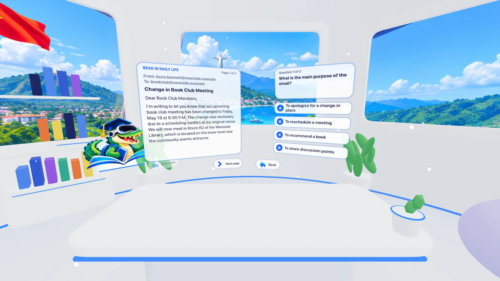

### Build a Sentence

The words lie on the desk as 3D tiles. Grab them and drop them into the slots, or pinch a tile to send it to the next free slot. When every slot is full, press **Check**.

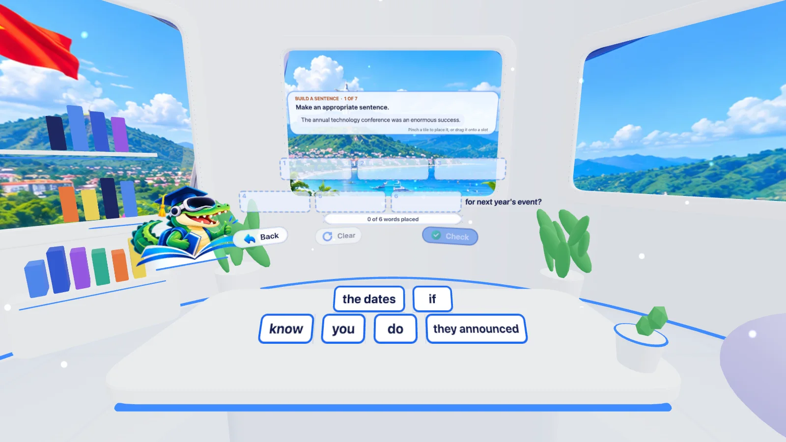

### Listening

A picture of the scene hangs in front of you, and the speakers stand or sit to your left and right, each voice coming from where that person is. After the audio, pinch an answer for each question.

The speakers are 3D people, and each question brings different ones, matched to the voices:

- **A cast of ten:** students, a librarian, a campus staff member, an older man wearing a *tais*, two professors, an announcer with a microphone, and two people in business clothes. Some stand and some sit on chairs.
- **Matched to the voice and the topic:** a woman's voice always gets a woman, two speakers are always two different people, and a conversation at the library prefers the librarian.
- **They talk like people:** while someone speaks, their mouth opens and closes with the real voice, their hands gesture, a ring glows at their feet and their name tag lights up. The other person turns to listen.

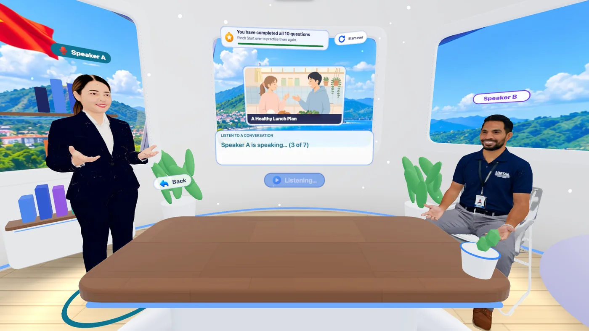

An announcement is read by the announcer, and an academic talk by a professor standing beside a lecture podium:

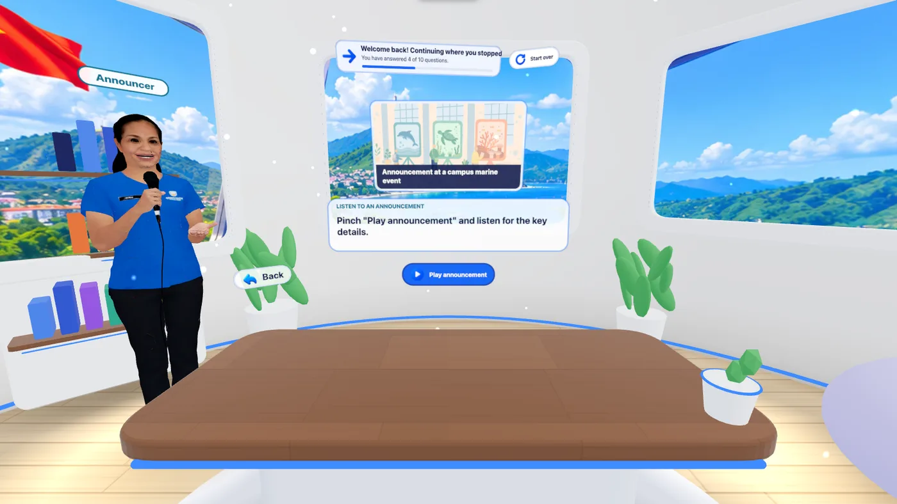

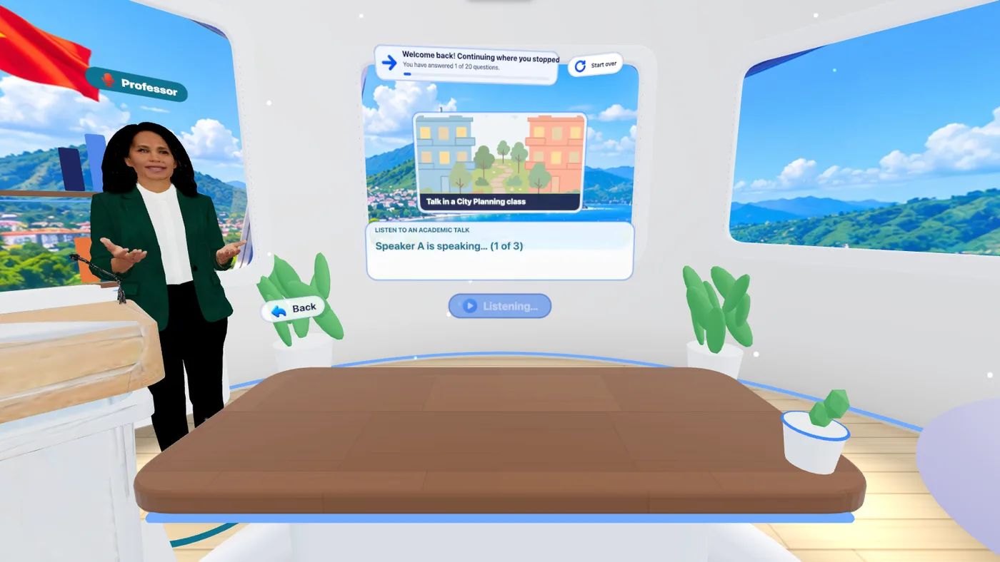

### Listen and Repeat

Hear a sentence, then repeat it into the headset microphone. You see which words matched in green, which you missed in red, and what you said.

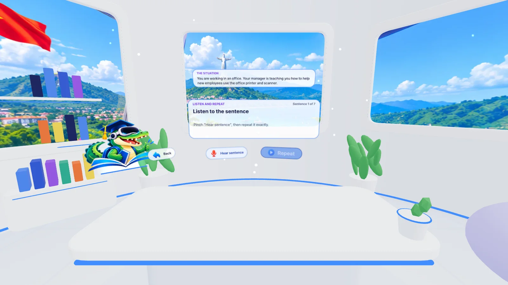

### Take an Interview

Lafaek, the LafaekTOEFL crocodile, sits across the desk in 3D and asks four questions out loud; its jaw moves with its voice and its hands gesture while it speaks. Pinch **Answer**, speak, and get a transcript, a band from 1 to 6, and coaching on what to improve. While you answer, Lafaek leans in to listen.

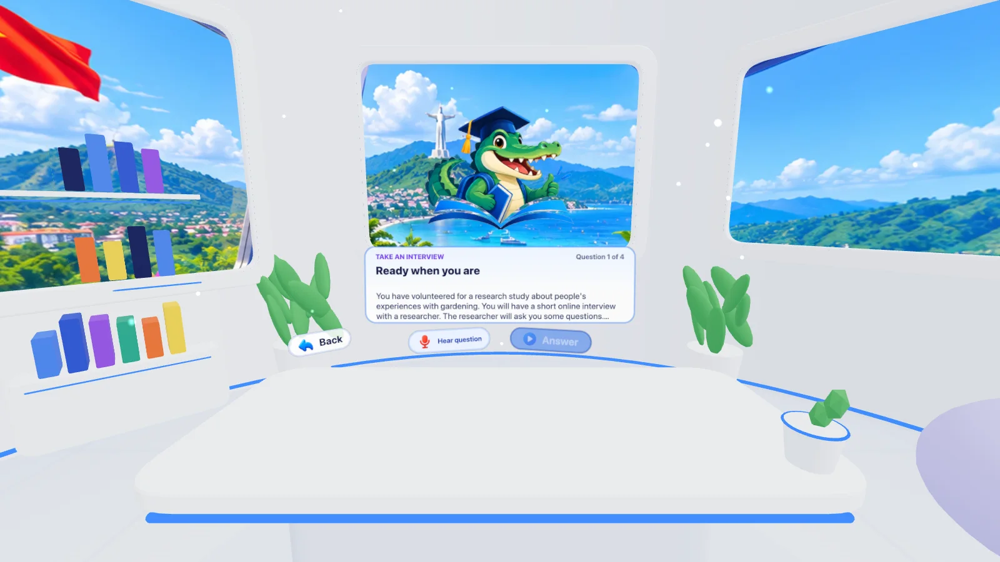

## Turn around: your live progress

The questions are in front of you. Your progress is **behind you**. Turn your head or your chair, and the back wall of the room shows a large **Progress Wall** with your own statistics:

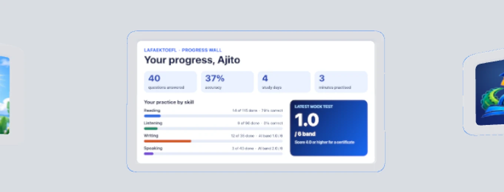

*A real learner's Progress Wall, seen when turning around in the room.*

| On the wall | What it shows |
| --- | --- |
| **Your progress, (your name)** | A greeting with your first name |
| **4 tiles** | Questions answered, accuracy, study days and minutes practised |
| **Your practice by skill** | A bar for Reading, Listening, Writing and Speaking: how many questions you have done out of how many you have, with your percentage correct or your AI band out of 6 |
| **Latest mock test** | Your overall band out of 6 and your certificate ID if you earned one. Before your first test it says "No mock test yet", and while a test is being scored it says "Being scored…" |

The wall is **live**. It reads the same data as the website, and it updates every time you come back to the hub, so the activity you just finished shows up straight away. Practice on the website counts too: answer a few questions on your phone, put the headset on, and the wall already shows them.

On either side of the wall hang a motto board, "Small steps every day lead to a big score!", and a painting from the app. Together they make the back of the room a place to see how far you have come.

## Tips

- **Recenter** whenever the desk feels too high, too low or too far away.
- **How to use** shows the hand tutorial again.
- **Music on / off** on the dock turns the background music off, and the room remembers your choice.
- The Quest asks for the microphone the first time you speak. Allow it for Listen and Repeat and the interview.
- **Exit to 2D** in the hub takes you back to the website.

## Your privacy

Spoken answers are handled exactly as on the website. They are turned into text for scoring and then deleted, unless you turn on *Keep my speaking recordings* in Settings. An account can be signed in on up to 3 devices; Settings lists them, and you can sign any of them out.

## How it is built

The room is built with Meta's **Immersive Web SDK (IWSDK)** on Three.js and runs in the Quest Browser through WebXR. It is a static build served next to the website, and it uses the same API routes and the same sign-in, so it needs no separate account or server.

- **The room** is drawn in code from simple shapes and small painted textures (the wood, the walls, the soft shadows and the sunlight are all textures, not real-time lighting), so it stays light on a Quest.
- **The people and Lafaek** are 3D models made with Meshy AI from our own design pictures, about 15,000 to 20,000 triangles and half a megabyte each. Only two are shown at a time.
- **Talking** needs no skeleton: a small vertex shader opens the jaw by the loudness of the voice and turns the forearms while a character speaks.
- **Sound:** the voices are spatial (Web Audio), the spoken introduction and the background music are two small recorded files, and the music fades out before any voice or recording.
- **Frame rate:** the target is 72 frames per second or more on Quest. Add `?fps=1` to the room's address for a frame-rate readout.

For the full picture, see [How it works](../diagram/README.md): diagram 6 shows the room and what each activity calls, and diagram 7 shows signing in on Quest with a code.
