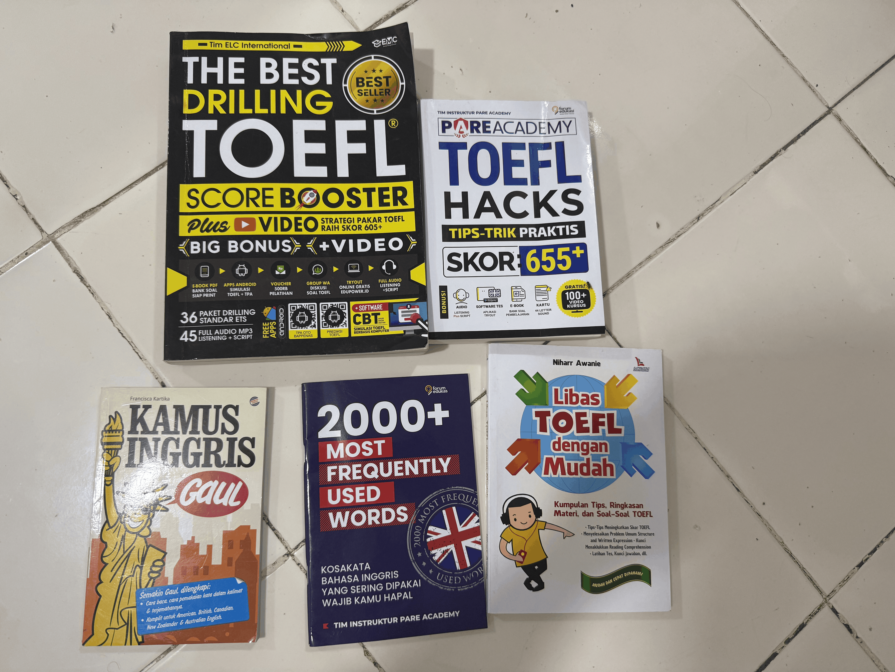
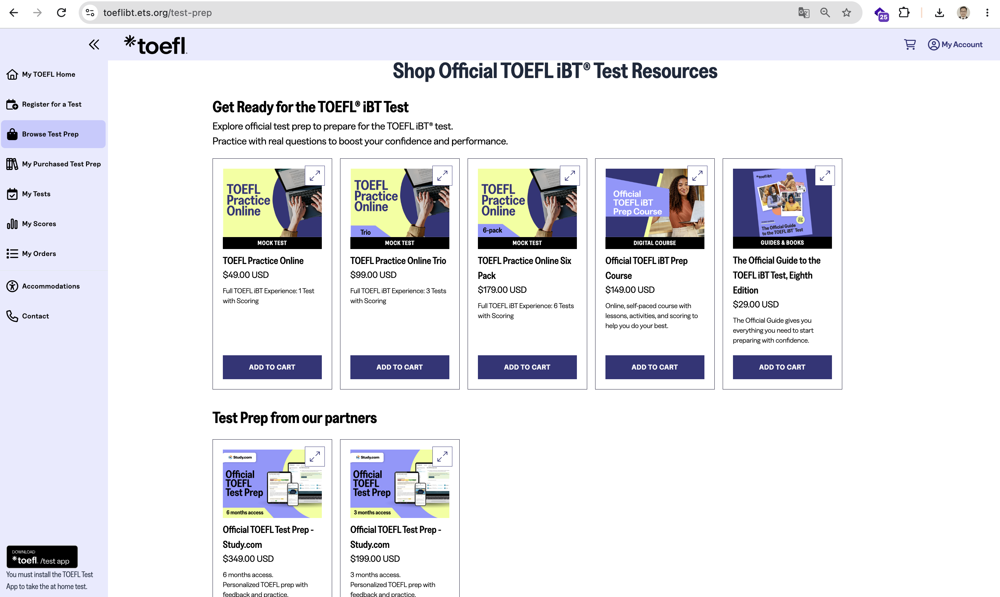
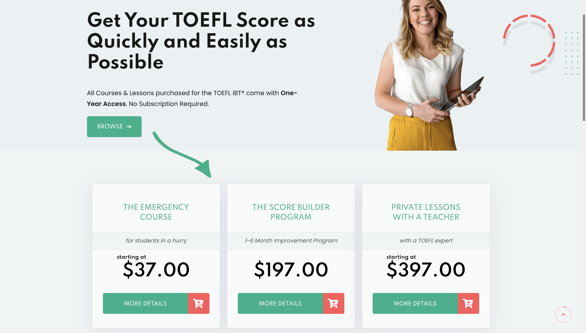
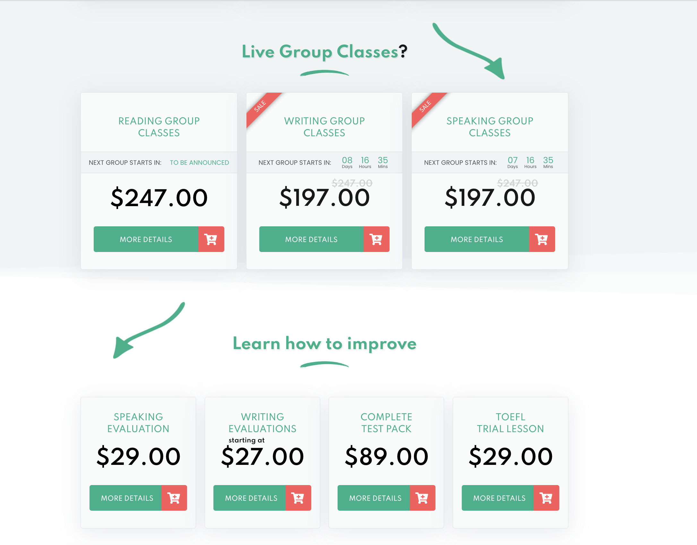
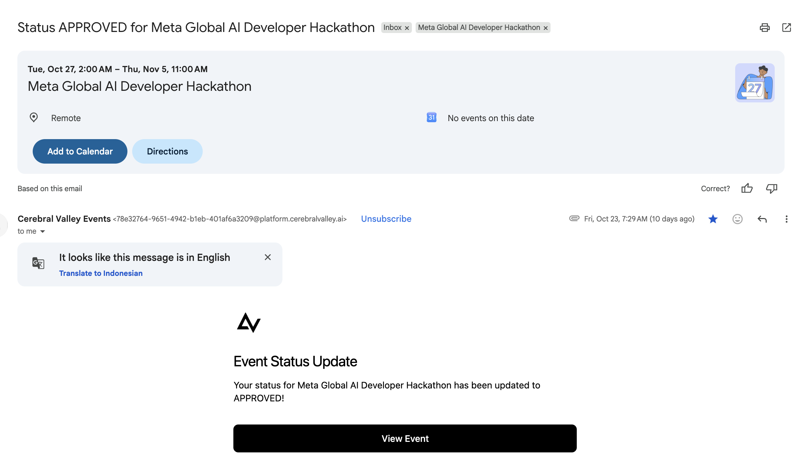
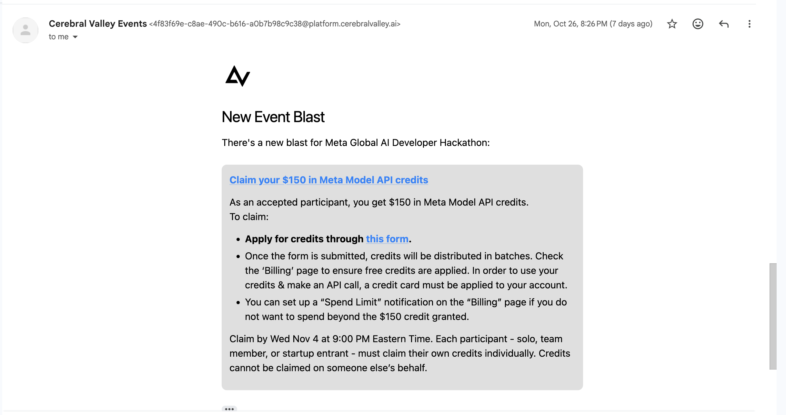

# Why I built LafaekTOEFL AI Coach

> A free, open-source AI coach for the new 2026 TOEFL, built in Dili, Timor-Leste, by someone who needed one.

## Where I'm starting from

I live in Dili, Timor-Leste. My goal is to study abroad in the United States, and for that I need a good TOEFL score. I have never taken the TOEFL before. I plan to sit the exam early next year, in January or February.

In Timor-Leste it is hard to find up-to-date study books, and the TOEFL is no exception. There are no bookshops here with the latest prep materials.

## $50 and two weeks for the wrong books

In October I ordered TOEFL preparation books from a marketplace in Indonesia, because I couldn't buy them at home. They cost me about **$50 USD** and took **two weeks** to arrive.

I made a study plan by hand to work through all of them. Then I found the problem: **the books cover the old test.** In January 2026 the TOEFL iBT changed to a new format, with new task types and a new 1–6 score scale. Everything I had bought was already out of date.

I had spent money and time on something I couldn't use.

## Looking for something better

My next stop was the official ETS website. The materials are good, but expensive for me. A single practice test costs $49, three cost $99, and the official prep course costs $149. ETS also has free practice, but it gives no feedback, so I would never know what I was doing wrong in writing or speaking.

I also tried other websites such as TST Prep. Their courses start at $37 and go up to $397 for private lessons. Live group classes cost $197–$247, and even a single speaking or writing evaluation costs $27–$29.

None of these fit what I needed: something **up to date** with the 2026 test, **affordable**, and able to **give real feedback** on my writing and speaking.

## Then I saw the Meta hackathon

I work as a data and AI engineer. One day I saw a post on social media about the **Meta Global AI Developer Hackathon**, and I knew straight away what I wanted to build.

I applied, and I was accepted.

As a participant I also received **$150 in Meta Model API credits** to build with Meta's newest models.

That gave me the chance to build the coach I couldn't find: **my own AI TOEFL coach**. I made it **open source**, so anyone can deploy their own copy. Anyone can also use it directly at **[lafaektoefl.tech](https://www.lafaektoefl.tech)**, and making a study plan there is free.

## How LafaekTOEFL solves my problems

| My problem | What LafaekTOEFL does |
| --- | --- |
| My books were for the old test | Every question follows the **new 2026 TOEFL**, across all 12 task types |
| I wrote my study plan by hand | The AI builds a **personal study plan** with questions, vocabulary and a weekly schedule |
| Free materials gave no feedback | **AI scores and coaching** for my writing and speaking |
| I only heard one accent | Listening audio in **American, British, Australian, Indian and African English** |
| A practice test cost $49 | My **first full mock test is free** |
| Books cost $50 and took two weeks | **Free to start, online, and open source** |

### Always the new test format

The app has no fixed question bank that can go out of date. Meta's **Muse Spark** writes fresh questions for all 12 task types of the TOEFL iBT that started in January 2026. These include Complete the Words, Read in Daily Life, Build a Sentence, Listen and Repeat and Take an Interview. I checked the formats against the official ETS practice tests, and the app checks every question before a learner sees it.

### A study plan made for me

I tell the app my level, my target band (1–6), my test date, the days I can study and for how long, and the accents I want to hear. LafaekTOEFL then builds:

- my own practice questions for every task type, with pictures and listening audio;
- a vocabulary list taken from those questions;
- a week-by-week schedule up to my test date.

The whole plan is ready in about **10–15 minutes**.

### Feedback on writing and speaking

When I write an email or an academic discussion post, or record my answers to the interview, the AI gives me a **band score** and explains what to improve. It uses criteria based on the ones ETS uses. For speaking, Meta's speech-to-text model first turns my voice into text. This is the feedback I couldn't get for free anywhere else.

### The accents of the real test

The listening audio uses the accents I choose. Each speaker also gets a voice that fits them: in a conversation between a woman and a man, you hear a woman's voice and a man's voice.

### A real mock test, and a certificate

I can take a full mock test that is timed like the real exam, with no pause, no replay and no retry. It gives me a band and a CEFR level for Reading, Listening, Writing and Speaking. With **4.0 or higher** I receive a certificate that anyone can verify online.

### Free and open

Anyone can sign up at [lafaektoefl.tech](https://www.lafaektoefl.tech) and start for free, with no subscription:

- The **free Starter** account includes 1 study plan and 1 mock test.
- If someone needs more, a **Boost Pack** costs $5 and adds 1 plan and 2 mock tests.
- The whole project is open source under the **MIT License**, so a school, a teacher or another developer can run their own copy for their students.

## How it's built

| Part | Technology |
| --- | --- |
| Web app | Next.js 15 and React 19 on **Vercel** |
| Background worker | Node.js on **Render**: writes questions, makes pictures and audio, rates mock tests |
| Database | **PostgreSQL** on Render |
| File storage | **AWS S3** (private) |
| Text AI | Meta **`muse-spark-1.3`**: questions, vocabulary, study schedules, scoring and coaching (`muse-spark-1.2` as fallback) |
| Image AI | Meta **`muse-image-1.0`**: pictures for practice questions |
| Speech-to-text | Meta **`muse-voice-transcribe-1.0`**: turns spoken answers into text |
| Voices | ElevenLabs `eleven_multilingual_v2`: listening audio in five accents |

See the [architecture diagrams](../docs/diagram/README.md) for how each part works, step by step.

---

This is the coach I wished I had when I was sitting in Dili with old books and no feedback. Now any learner with an internet connection, in Timor-Leste or anywhere else, can prepare for the new TOEFL for free.
