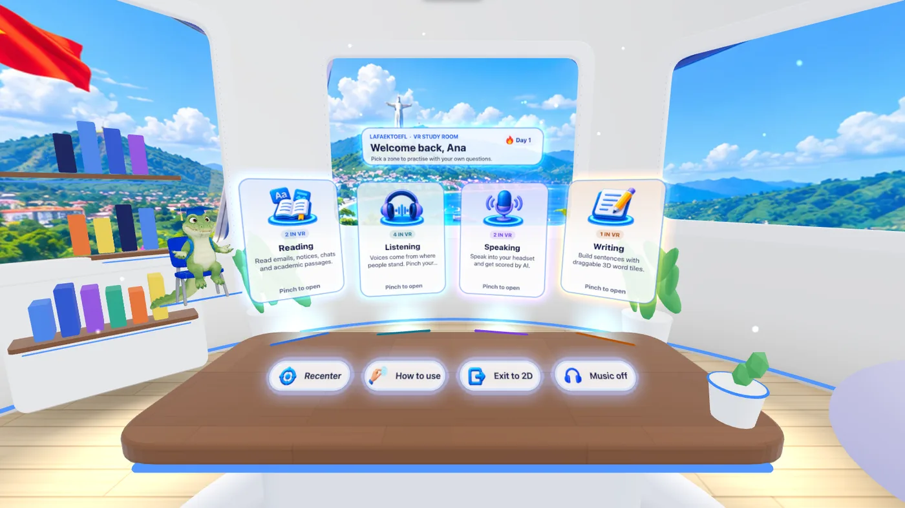

# VR Study Room

The LafaekTOEFL **VR Study Room**: a seated, hands-first virtual classroom for Meta Quest where a learner practises 9 of the 12 TOEFL tasks with their own study-plan questions. It is built with Meta's **Immersive Web SDK (IWSDK)** on Three.js and runs in the Quest Browser through WebXR, so there is nothing to install on the headset.

This folder is the room's source. It builds into `../public/vr/room/`, which the LafaekTOEFL web app serves at `/vr/room`.

- **For learners:** [VR Study Room guide](../docs/vr/README.md) (what it is, how to get in, how to use your hands).
- **How it fits the whole app:** [How it works](../docs/diagram/README.md), diagrams 6 and 7.



## What is in the room

| | |
| --- | --- |
| **4 zones, 9 tasks** | Reading (2), Listening (4), Speaking (2) and Build a Sentence |
| **Hands only** | Point and pinch, pinch and hold to grab word tiles, touch the dock. Controllers work but are never needed. |
| **Seated** | Everything is within arm's reach of a chair; Recenter fits the desk to the learner |
| **3D characters** | Ten Listening speakers and Lafaek, the crocodile interviewer, with mouths and hands that move as they talk |
| **Spatial audio** | Each voice comes from where its speaker is |
| **Same account and data** | Same sign-in, questions, scoring and progress as the website, through the same API routes |
| **Continue where you stopped** | Each activity resumes at the first unanswered question, with a live progress bar and Start over |
| **Guest demo** | "Try the demo, no account" signs a visitor in as a temporary guest with sample questions (server side: `lib/server/auth/guest.ts`, enabled by `DEMO_CONTENT_EMAIL`) |

## Run it

The room needs the LafaekTOEFL web app for sign-in and questions. Start the web app first (see the [main README](../README.md)), then in this folder:

```sh
npm install
VR_API_TARGET=http://localhost:3000 npm run dev
```

`npm run dev` starts IWSDK's managed browser with its XR emulator (hands and controllers) at `https://localhost:8081`. `VR_API_TARGET` sends `/api` requests to the running web app, so the emulator uses real study-plan data. Sign in on the web app's own pages first, or use the code sign-in.

From the repository root, `npm run vr:dev` and `npm run vr:build` do the same as `npm run dev` and `npm run build` here.

| Command | What it does |
| --- | --- |
| `npm run dev` | The room in IWSDK's managed browser with the XR emulator |
| `npm run dev:runtime` | Plain Vite dev server, without the managed browser |
| `npm run typecheck` | TypeScript check (run it before testing: type errors can stop systems silently) |
| `npm run build` | Builds into `../public/vr/room/` |

**Vercel does not build this folder.** After changing the room, run `npm run build` and commit `public/vr/room/` together with the source.

### Address options

| Option | Effect |
| --- | --- |
| `?mode=preview` | Opens the room in a normal browser, looked around with the mouse (no headset) |
| `?open=<screen>` | Starts at one screen: `zone-reading`, `zone-listening`, `zone-speaking`, `zone-writing`, `reading-daily`, `reading-academic`, `sentence`, `listen-response`, `listen-conversation`, `listen-announcement`, `listen-talk`, `repeat`, `interview` |
| `?fps=1` | Shows a frame-rate readout in the corner of the view |

## Testing

- **In the emulator:** switch the input to hands and try all three gestures. With the IWSDK CLI, a hand press can be scripted, for example:

  ```sh
  npx @iwsdk/cli xr set-input-mode --input-json '{"mode":"hand"}'
  npx @iwsdk/cli xr list-targets --input-json '{}'
  ```

  Buttons, answer cards, zone cards and word tiles have stable names for this (`Btn_Back`, `Option_A`, `Station_zone-listening`, `Tile_0`).
- **In a normal browser:** `?mode=preview` plus a screenshot tool is enough to check layout. In development the world is exposed as `window.__vrWorld` so a script can find those names; this is not in the production build.
- **Signed-in automated tests:** `VR_DEV_COOKIE="lafaek_session=<token>"` makes the dev proxy send that session cookie, so the managed browser is signed in without typing. Development only.
- **On a Quest:** open the address from `npx @iwsdk/cli dev status` on the same Wi-Fi, or the deployed site. Use `?fps=1` to watch the frame rate; the target is 72 frames per second or more.

## How it is organised

`iwsdk.config.json` is the project authority (XR mode, hand tracking, features). The room is built in code, so the scene file only holds the sky and light.

| File | What it holds |
| --- | --- |
| `index.html` | The welcome card (greeting, spoken introduction, Enter VR, Preview) |
| `src/index.ts` | Start-up: sign-in and study-plan checks, the guest demo button, screen registration, the welcome card's buttons (Preview becomes the main one on a device without WebXR) |
| `src/app.ts` | The app shell: hub and zone menus, the dock, the hand tutorial, the 3D companion, switching screens |
| `src/room.ts` | The classroom, drawn in code: walls, oak floor, walnut desk, windows, shelves, plants, soft shadows, sunlight |
| `src/ui.ts` | Canvas-texture panels, buttons and answer cards |
| `src/clicks.ts`, `src/interaction.ts` | Presses for pinch, touch and mouse; small animations |
| `src/data.ts` | The LafaekTOEFL API client: questions, answers, speech, progress, Start over |
| `src/reading.ts`, `src/sentence.ts`, `src/listening.ts`, `src/repeat.ts`, `src/interview.ts` | The activities |
| `src/resume.ts` | The "Welcome back" bar and Start over |
| `src/speakers.ts` | The cast of Listening speakers, their measurements, and who is picked for a question |
| `src/talk.ts` | Mouth and hand movement while a character talks (a vertex shader, no skeleton) |
| `src/models.ts`, `src/assets.ts` | Loading and sizing the glTF models |
| `src/sound.ts` | Sound effects, spatial voices and background music |
| `src/progress.ts` | The live progress wall behind the learner |
| `src/wav.ts` | Turns a microphone recording into 16 kHz WAV for transcription |
| `src/fps.ts` | The `?fps=1` frame-rate readout |
| `src/figure.ts` | Fallback: a relief figure from a cutout photo, used if a speaker model cannot load |

## Design rules the code follows

- **Hands first.** Every press works with a pinch; dock buttons also work with a fingertip touch and with a pinch right next to them. Presses act on release, so sliding off a far button cancels it.
- **Nothing is pressed before its media has loaded.** Buttons that play a picture or audio stay disabled, with a loading state, until it is ready.
- **Light on a Quest.** The room is simple shapes with painted canvas textures; shadows and sunlight are textures, not real-time lighting. Characters are about 15,000 to 20,000 triangles and only two are shown at once. Nothing allocates per frame.
- **Voices are never covered.** Background music plays only on the quiet screens and is silent in Listening, Listen and Repeat and the interview.
- **One source of truth.** The room keeps no data of its own: answers, scores and progress all go through the web app's API.

## Assets and credits

- 3D models: [`public/models/CREDITS.md`](public/models/CREDITS.md)
- Sounds, voice and music: [`public/audio/CREDITS.md`](public/audio/CREDITS.md)
- Icons and pictures in `public/icons` and `public/img` are LafaekTOEFL's own artwork.
